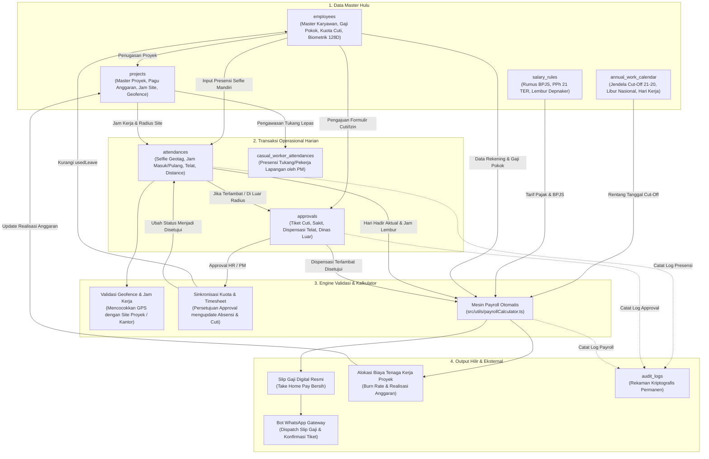

# BUKU PANDUAN PENGGUNAAN SISTEM PRIME HRIS ENTERPRISE
**Edisi:** v2.4-LTS (Dedicated Role-Based Manual Release)  
**Nomor Dokumen:** `DOC-PRIME-HRIS-MANUAL-2026-V2`  
**Klasifikasi:** Enterprise Restricted Standard / Manual Operasional Resmi Korporat  
**Lead Systems Architect:** Galih Primananda (PT Prime Infinity Systems / Prime Projectx)  
**Repositori SSOT:** `https://github.com/PrimeFox59/prime-hris.git`  

---

## DAFTAR ISI LENGKAP & TERSTRUKTUR

- [LEMBAR PENGESAHAN ARSITEKTUR DIGITAL & PENGENDALIAN MUTU](#lembar-pengesahan-arsitektur-digital--pengendalian-mutu)
- [BAB I: ARSITEKTUR DASAR SISTEM & PENJELASAN MENDALAM RBAC 5-TIER](#bab-i-arsitektur-dasar-sistem--penjelasan-mendalam-rbac-5-tier)
  - 1.1 Filosofi Zero Manual System
  - 1.2 Pilar Arsitektur Edge-Cloud Hybrid
  - 1.3 Penjelasan Mendalam Konsep & Matriks RBAC 5-Tier
  - 1.4 Hirarki & Hak Akses Pengguna
- [BAB II: STRUKTUR DATA, SILSILAH ENTITAS & PETA KETERKAITAN DATA (DATA LINEAGE)](#bab-ii-struktur-data-silsilah-entitas--peta-keterkaitan-data-data-lineage)
  - 2.1 Peta Topologi Keterkaitan Data End-to-End
  - 2.2 Kamus Entitas Master & Transaksional Lengkap
  - 2.3 Matriks Hubungan Antar-Tabel (Dari Mana ke Mana & Fungsinya)
  - 2.4 Matriks Ketergantungan Data & Efek Domino (Cascading Impact)
- [BAB III: ALUR KERJA PRESENSI LENGKAP & MULTI-METODE (5 SKENARIO)](#bab-iii-alur-kerja-presensi-lengkap--multi-metode-5-skenario)
  - 3.1 Skenario 1: Presensi Kamera Selfie GPS Satelit Mandiri
  - 3.2 Skenario 2: Presensi Tukang Lapangan / Pekerja Harian Lepas
  - 3.3 Skenario 3: Terminal Kiosk Publik di Lobby / Site Gate
  - 3.4 Skenario 4: Presensi Penugasan Dinas Luar (Out-of-Geofence)
  - 3.5 Skenario 5: Rekonsiliasi & Koreksi Jam Kehadiran oleh HR
- [BAB IV: PANDUAN KHUSUS ROLE 1 — STAFF (KARYAWAN & TEKNISI UMUM)](#bab-iv-panduan-khusus-role-1--staff-karyawan--teknisi-umum)
  - 4.1 Profil Peran & Batasan Wewenang Staff
  - 4.2 Detail 5 Menu Navigasi Staff (Tujuan, Fungsi Tombol, Input & Keterkaitan)
  - 4.3 Alur Operasional Harian Staf (Daily Workflow)
  - 4.4 Keterkaitan Data Staf ke Peran Lain (PM, HR, Finance)
- [BAB V: PANDUAN KHUSUS ROLE 2 — PROJECT MANAGER & SITE COORDINATOR](#bab-v-panduan-khusus-role-2--project-manager--site-coordinator)
  - 5.1 Profil Peran & Wewenang Khusus PM di Lapangan
  - 5.2 Detail Menu Manajemen Proyek, Presensi Tukang & Otorisasi Tim
  - 5.3 Alur Kerja Harian PM di Lokasi Proyek
  - 5.4 Keterkaitan Data Proyek ke HR dan Finance (Labor Cost Allocation)
- [BAB VI: PANDUAN KHUSUS ROLE 3 — HR / ADMIN SDM](#bab-vi-panduan-khusus-role-3--hr--admin-sdm)
  - 6.1 Profil Peran & Wewenang Personalia
  - 6.2 Detail 9 Menu Navigasi HR (Master Karyawan, Biometrik, Approval, Kalender)
  - 6.3 Siklus Bulanan & Tata Kelola Kuota Cuti / Roster
  - 6.4 Keterkaitan Data HR terhadap Payroll Finance & Legal Ketenagakerjaan
- [BAB VII: PANDUAN KHUSUS ROLE 4 — FINANCE & PAYROLL SPECIALIST](#bab-vii-panduan-khusus-role-4--finance--payroll-specialist)
  - 7.1 Profil Peran & Otoritas Keuangan Perusahaan
  - 7.2 Detail 9 Menu Navigasi Finance (Payroll, Bank Transfer, Invoice, Labor Cost)
  - 7.3 Siklus Tutup Buku Penggajian Bulanan Step-by-Step
  - 7.4 Keterkaitan Data Finansial ke Anggaran Proyek & Distribusi Slip WhatsApp
- [BAB VIII: PANDUAN KHUSUS ROLE 5 — SUPERUSER & MANAJEMEN DIREKSI](#bab-viii-panduan-khusus-role-5--superuser--manajemen-direksi)
  - 8.1 Profil Peran & Wewenang Eksekutif Root
  - 8.2 Detail Menu Dashboard Terpadu, Setting Geofence & Aturan Gaji
  - 8.3 Prosedur Emergency Recovery, Backup Database & Audit Trail Kriptografis
- [BAB IX: FORMULA PERHITUNGAN MATEMATIS & ATURAN BISNIS FINANSIAL](#bab-ix-formula-perhitungan-matematis--aturan-bisnis-finansial)
  - 9.1 Formula Lembur Depnaker RI (PP 35/2021)
  - 9.2 Formula Denda Keterlambatan Bertingkat
  - 9.3 Formula BPJS Ketenagakerjaan & Kesehatan
  - 9.4 Formula PPh 21 TER (PP 58/2023)
  - 9.5 Formula Pembebanan Biaya Tenaga Kerja ke Proyek
- [BAB X: PANDUAN INTEGRASI ENGINE OTOMATIS & BACKEND SERVICES](#bab-x-panduan-integrasi-engine-otomatis--backend-services)
  - 10.1 WhatsApp Bot Baileys Socket & Whitelist Opt-In
  - 10.2 SMTP Nodemailer Gateway
  - 10.3 Engine AI Wajah ResNet 128D & Anti-Spoofing
- [BAB XI: TROUBLESHOOTING MANDIRI BERDASARKAN PERAN & FAQ](#bab-xi-troubleshooting-mandiri-berdasarkan-peran--faq)
  - 11.1 Matriks Solusi Masalah untuk Staf Lapangan
  - 11.2 Matriks Solusi Masalah untuk PM & HR Admin
  - 11.3 FAQ Komprehensif
- [BAB XII: DAFTAR ISTILAH & GLOSARIUM ENTERPRISE](#bab-xii-daftar-istilah--glosarium-enterprise)

---

## LEMBAR PENGESAHAN ARSITEKTUR DIGITAL & PENGENDALIAN MUTU

Sesuai Kebijakan Rekayasa Sistem Prime Projectx, dokumen manual operasional ini merupakan **System-Automated Digital Enterprise Report**. Kebenaran logika arsitektur, relasi entitas basis data SQLite WAL, integrasi socket WhatsApp Baileys, serta formula kalkulator payroll diverifikasi langsung terhadap basis kode produksi aktif pada repositori `https://github.com/PrimeFox59/prime-hris.git`.

> [!NOTE]
> **Prinsip Pemisahan Buku Panduan Per Peran (Role Separation):**  
> Untuk mencegah kebingungan pengguna di lapangan, buku panduan ini membagi panduan operasional ke dalam bab-bab khusus independen untuk setiap peran (Staff, Project Manager, HR, Finance, Superuser). Pengguna hanya perlu membaca bab yang sesuai dengan perannya masing-masing untuk memahami seluruh tugas, fungsi tombol, input data, dan keterkaitan data yang dihasilkannya.

---

## BAB I: ARSITEKTUR DASAR SISTEM & PENJELASAN MENDALAM RBAC 5-TIER

### 1.1 Filosofi Zero Manual System
PRIME HRIS Enterprise dibangun dengan visi tunggal: **Zero Manual System**. Seluruh gesekan operasional yang lazim memperlambat produktivitas perusahaan manufaktur, kontraktor, dan multi-cabang dieliminasi melalui otomatisasi cerdas:
- Tidak ada lagi pencatatan presensi kertas yang rentan manipulasi atau hilang.
- Tidak ada lagi rekap lembur manual di spreadsheet berhari-hari menjelang tanggal gajian.
- Tidak ada lagi pencetakan dan pembagian slip gaji fisik secara manual.

### 1.2 Pilar Arsitektur Edge-Cloud Hybrid
Sistem beroperasi di atas 4 pilar arsitektur modern:
1. **Frontend Responsif Multi-Platform:** React 18, TypeScript, Tailwind CSS, Lucide Icons, dan Apache ECharts dengan caching cerdas lokal.
2. **Backend Runtime Node.js:** Server HTTP mandiri dengan kompresi data otomatis GZIP, Server-Sent Events (SSE) untuk sinkronisasi live data.
3. **Database SQLite 3 Native Berbasis WAL:** Menggunakan modul native `node:sqlite` dengan Write-Ahead Logging (WAL) dan `PRAGMA synchronous = NORMAL`, latensi baca/tulis instan di bawah 5 milidetik, tanpa dependensi server database eksternal.
4. **WhatsApp Gateway Mandiri:** Engine Baileys multi-device socket yang terhubung langsung ke WhatsApp Web tanpa vendor berbayar pihak ketiga.

### 1.3 Penjelasan Mendalam Konsep & Matriks RBAC 5-Tier (Role-Based Access Control)
Untuk menjamin integritas data korporat dan menerapkan prinsip pemisahan wewenang (*Segregation of Duties*), sistem membagi otorisasi ke dalam 5 tingkatan peran:

| Tingkatan Peran | Definisi & Profil Pengguna | Menu Navigasi yang Terlihat | Otoritas Tulis / Modifikasi | Batas Kerahasiaan Finansial |
| :--- | :--- | :--- | :--- | :--- |
| **1. Staff (Umum / Teknisi)** | Karyawan kantor, operator workshop, dan teknisi lapangan. | **5 Menu:** • Portal Kinerja Saya • Presensi Kamera Saya • Pengajuan & Izin Saya • Slip Gaji Saya • Profil Data Saya | Hanya dapat menginput presensi diri sendiri dan mengirim formulir permohonan izin/cuti pribadi. | **Pribadi:** Hanya melihat slip gaji dan nomor rekening bank miliknya sendiri. |
| **2. Staff (Project Manager)** | Site Manager, Site Lead, Mandor yang memimpin proyek di lapangan. | **6 Menu:** • 5 Menu Staf di atas • PLUS: Presensi Tukang Lapangan • Otorisasi Tim Proyek | Mendaftarkan tukang harian lepas, mencatat foto absensi tukang, dan mereview tiket staf proyek. | **Proyek:** Memantau serapan anggaran upah proyek yang dikelolanya (tidak melihat gaji staf lain). |
| **3. HR / Admin SDM** | HR Manager, Supervisor Personalia, dan Admin Personalia. | **9 Menu:** • Dashboard HRIS • Presensi & Jam Kerja • Pusat Approval SDM • Presensi Tukang • Manajemen Proyek • Data Karyawan • Kalender Kerja • Setting System • Audit Trail | Penuh pada data personalia: input staf baru, enrol biometrik, jadwal cut-off, approval tiket, koreksi timesheet. | **Personalia:** Melihat profil kompensasi seluruh staf untuk keperluan administrasi cuti dan roster. |
| **4. Finance & Payroll** | Finance Manager, Payroll Specialist, dan Bagian Keuangan. | **9 Menu:** • Dashboard Keuangan • Payroll & Penggajian • Data Gaji Karyawan • Biaya Tenaga Kerja • Approval Lembur • Rekap Presensi • Kalender Kerja • Invoice Resmi • Audit Trail | Penuh pada data finansial: menjalankan kalkulasi payroll, penyesuaian gaji, ekspor CSV bank, dispatch slip WA. | **Tinggi (Komersial):** Otoritas penuh atas seluruh data payroll perusahaan, rekening bank, dan penagihan invoice. |
| **5. Superuser / Direksi** | Direktur Utama, Technical Lead, dan Platform Architect sistem. | **10 Menu Terpadu:** Seluruh menu sistem tanpa batasan, termasuk konfigurasi master sistem dan database. | Bypass Otoritas Penuh: mengubah formula salary_rules, geofence pusat, pairing QR WA, reset password root. | **Tertinggi:** Akses mutlak ke seluruh data finansial, log audit root, dan pemulihan bencana database. |

---

## BAB II: STRUKTUR DATA, SILSILAH ENTITAS & PETA KETERKAITAN DATA (DATA LINEAGE)

### 2.1 Peta Topologi Keterkaitan Data End-to-End

### 2.2 Matriks Hubungan Antar-Tabel (Dari Mana ke Mana dan Fungsinya)

| Tabel Asal & Kunci | Tabel Tujuan (Relasi) | Arah Aliran & Kardinalitas | Fungsi Bisnis & Dampak Operasional |
| :--- | :--- | :--- | :--- |
| `employees.id` | `attendances.employeeId` | `employees` $\rightarrow$ `attendances` (1 : N) | Mengikat setiap transaksi absensi harian (jam masuk/pulang, foto, koordinat) ke identitas karyawan pemilik data. |
| `employees.assignedProjectId` | `projects.id` | `employees` $\rightarrow$ `projects` (N : 1) | Menentukan di proyek mana staf bertugas. Menentukan aturan jam kerja khusus site dan radius toleransi GPS proyek. |
| `attendances.id` | `approvals.attendanceRecordId` | `attendances` $\rightarrow$ `approvals` (1 : 1) | Jika presensi berstatus terlambat (`LATE`) atau di luar geofence, sistem mengaitkan tiket dispensasi ke rekaman absensi terkait. |
| `approvals.employeeId` | `employees.id` | `approvals` $\rightarrow$ `employees` (N : 1) | Tiket permohonan cuti tahunan yang disetujui HR secara seketika memotong saldo `employees.leaveQuota` dan menambah `usedLeave`. |
| `projects.id` | `casual_workers.projectId` | `projects` $\rightarrow$ `casual_workers` (1 : N) | Mengelompokkan daftar tukang harian lepas yang bekerja pada kontrak proyek tertentu di bawah pengawasan PM. |
| `attendances` + `approvals` | `payrollCalculator` Engine | `attendances` $\rightarrow$ `Payroll` $\rightarrow$ `projects` | Menjadi bahan baku penghitungan hari hadir riil, jam lembur Depnaker, dan pembebanan biaya upah ke anggaran proyek. |
| `payrollCalculator` | `wa_notifications.recipient_phone` | `Payroll` $\rightarrow$ `wa_notifications` $\rightarrow$ WhatsApp | Memicu bot WhatsApp mengirimkan rincian slip gaji resmi secara digital ke nomor ponsel masing-masing staf. |

---

## BAB III: ALUR KERJA PRESENSI LENGKAP & MULTI-METODE (5 SKENARIO)

### 3.1 Skenario 1: Presensi Kamera Selfie GPS Satelit Mandiri
Digunakan setiap hari oleh staf kantor pusat, workshop, dan teknisi site yang memegang smartphone/komputer pribadi:
1. **Langkah 1 (Sensor):** Karyawan membuka menu *Presensi Kamera Saya*. Browser meminta izin sensor kamera depan dan lokasi GPS.
2. **Langkah 2 (Geofence):** Sistem membaca koordinat satelit (Latitude & Longitude) dan menghitung jarak ke lokasi kerja menggunakan rumus bola bumi Haversine. Jika jarak $\le 100$ meter, indikator berubah **HIJAU** (*Dalam Radius*).
3. **Langkah 3 (Biometrik):** Karyawan memposisikan wajah di dalam oval panduan layar. Algoritma FaceNet AI mendeteksi landmark wajah dan menampilkan indikator *Wajah Terdeteksi*.
4. **Langkah 4 (Check-In):** Karyawan menekan tombol **CHECK IN SEKARANG**. Sistem mengambil snapshot foto, memverifikasi kecocokan vektor biometrik dengan master data (skor $\ge 90\%$), dan mencatat jam masuk.
5. **Langkah 5 (Deteksi Telat):** Jika check-in dilakukan melewati batas toleransi shift (misal lewat dari 08:15), status otomatis menjadi `LATE`, sistem menghitung menit terlambat, dan meminta karyawan menuliskan alasan.
6. **Langkah 6 (Check-Out):** Pada sore hari saat jam kerja berakhir, karyawan menekan **CHECK OUT SEKARANG** untuk mengunci total jam kerja hari tersebut.

### 3.2 Skenario 2: Presensi Tukang Lapangan / Pekerja Harian Lepas
Khusus dioperasikan oleh Project Manager di lapangan untuk mengawasi tenaga kerja lepas yang tidak memiliki akun sistem:
1. **Langkah 1 (Akses):** PM membuka menu *Presensi Tukang Lapangan* pada ponselnya di lokasi site proyek.
2. **Langkah 2 (Pilih Proyek):** PM memilih proyek aktif, lalu mengklik *Ambil Absen Harian Tukang*.
3. **Langkah 3 (Foto Site):** Kamera smartphone PM terbuka. PM mengarahkan kamera ke wajah pekerja tukang yang hadir di lokasi proyek pagi itu.
4. **Langkah 4 (Watermark):** Sistem mengambil foto, menyematkan watermark tanggal, jam, koordinat GPS proyek, dan nama PM yang memverifikasi.
5. **Langkah 5 (Arsip):** Presensi tersimpan di tabel `casual_worker_attendances` sebagai bukti fisik untuk klaim kas proyek dan progress billing.

### 3.3 Skenario 3: Terminal Kiosk Publik di Lobby / Site Gate
Dioperasikan pada tablet layar sentuh permanen di lobby kantor atau pos satpam gerbang workshop:
1. **Langkah 1 (Setup Kiosk):** Tablet dioperasikan dengan URL khusus: `https://hris.primeprojectx.net/?tab=kiosk` (*Mode Sandboxed Publik Bebas Login*).
2. **Langkah 2 (Proteksi Data):** Layar kiosk bersih dan aman, sama sekali tidak menampilkan data rahasia seperti besaran gaji atau nomor rekening.
3. **Langkah 3 (Pindai Kilat):** Karyawan mendekati tablet: Kamera kiosk mendeteksi wajah dan mencocokkan dengan galeri biometrik dalam tempo $< 0.8$ detik (Opsi Wajah), atau karyawan mengetikkan 4 digit NIK pada keypad (Opsi PIN).
4. **Langkah 4 (Konfirmasi):** Layar menampilkan konfirmasi hijau: *Selamat Bekerja, [Nama Karyawan]* dan membunyikan nada sukses.

### 3.4 Skenario 4: Presensi Penugasan Dinas Luar (Out-of-Geofence)
Digunakan saat karyawan harus langsung berangkat ke lokasi vendor/klien di luar perimeter kantor:
1. **Langkah 1 (Mode Dinas):** Karyawan membuka menu presensi kamera di lokasi klien, memilih tombol mode **DINAS LUAR**.
2. **Langkah 2 (Snapshot GPS):** Sistem mengambil snapshot foto dan koordinat GPS riil di lokasi klien tersebut.
3. **Langkah 3 (Keterangan):** Karyawan menuliskan keterangan tugas dinas luar (nama klien, agenda meeting, nomor surat tugas).
4. **Langkah 4 (Tiket Otomatis):** Sistem mencatat presensi sebagai `DINAS_LUAR` dan secara otomatis membuat tiket dispensasi di antrean HR/PM untuk disetujui.

### 3.5 Skenario 5: Rekonsiliasi & Koreksi Jam Kehadiran oleh HR
Digunakan jika terjadi pemadaman listrik di site atau kegagalan perangkat keras:
1. **Langkah 1 (Pengajuan):** Karyawan mengajukan tiket *Koreksi Absensi* dengan melampirkan jam masuk/pulang yang seharusnya.
2. **Langkah 2 (Audit Timesheet):** HR Manager membuka menu *Payroll & Penggajian* $\rightarrow$ Klik nama staf $\rightarrow$ Buka *Employee Timesheet Detail Modal*.
3. **Langkah 3 (Koreksi Jam):** HR memilih tanggal yang bersangkutan, mengklik tombol *Koreksi Jam HR*, memasukkan jam riil, dan memberikan catatan verifikasi resmi.
4. **Langkah 4 (Penyelarasan):** Sistem memperbarui status absensi menjadi `ON_TIME`, membatalkan denda keterlambatan, dan mencatat mutasi tersebut ke tabel `audit_logs` permanen.

---

## BAB IV: PANDUAN KHUSUS ROLE 1 — STAFF (KARYAWAN & TEKNISI UMUM)

### 4.1 Profil Peran & Batasan Wewenang Staff
Role Staff diperuntukkan bagi seluruh karyawan operasional, teknisi workshop, staf administrasi, dan pekerja lapangan. Peran ini berfokus pada kemandirian pencatatan kehadiran pribadi dan transparansi hak kompensasi kerja. Staff sama sekali tidak memiliki akses ke data personalia staf lain, pengaturan sistem, maupun kalkulasi penggajian perusahaan.

### 4.2 Pembahasan Mendalam 5 Menu Navigasi Staff

#### Menu 1: PORTAL KINERJA SAYA (Dashboard Pribadi)
- **Lokasi Navigasi:** Menu paling atas pada bilah navigasi kiri (Ikon: `LayoutDashboard`).
- **Tujuan Bisnis:** Memberikan gambaran seketika kepada karyawan mengenai performa kedisiplinan dan hak cuti bulan berjalan.
- **Komponen UI & Fungsi Tombol:**
  - *Kartu Hadir Tepat Waktu:* Menampilkan jumlah hari masuk kerja tepat waktu bulan ini.
  - *Kartu Menit Keterlambatan:* Menampilkan akumulasi menit keterlambatan yang belum mendapatkan dispensasi dari atasan.
  - *Kartu Sisa Kuota Cuti:* Menampilkan sisa hari cuti tahunan yang masih dapat diajukan.
  - *Kartu Penugasan Proyek:* Menampilkan nama proyek aktif tempat staf ditugaskan beserta nama Project Manager penanggung jawabnya.
- **Keterkaitan Data:** Menarik data secara real-time dari tabel `attendances` (filter `employeeId`), tabel `approvals` (status tiket pribadi), dan tabel `employees` (`leaveQuota - usedLeave`).

#### Menu 2: PRESENSI KAMERA SAYA (Kamera Selfie & Geotag)
- **Lokasi Navigasi:** Menu kedua pada bilah navigasi kiri (Ikon: `Camera`).
- **Tujuan Bisnis:** Melakukan pencatatan kehadiran masuk dan pulang secara mandiri dengan validasi satelit GPS dan biometrik wajah.
- **Komponen UI & Fungsi Tombol:**
  - *Viewport Video Kamera:* Menampilkan live feed kamera depan perangkat dengan lingkaran oval panduan wajah.
  - *Indikator Status Radius Geofence:* Lingkaran radar satelit. Berwarna HIJAU jika jarak ke kantor/proyek $\le 100$m. Berwarna KUNING/MERAH jika di luar radius toleransi.
  - *Tombol 'CHECK IN SEKARANG':* Tombol besar berwarna hijau/navy yang diklik pada pagi hari untuk merekam jam masuk kerja.
  - *Tombol 'CHECK OUT SEKARANG':* Tombol yang aktif pada sore/malam hari saat jam kerja berakhir untuk merekam jam kepulangan.
  - *Pilihan Mode 'Dinas Luar':* Opsi yang dapat dicentang jika karyawan ditugaskan di luar lokasi kantor/proyek secara resmi.
- **Keterkaitan Data:** Menulis baris baru ke tabel `attendances`, memicu notifikasi bot WhatsApp ke nomor ponsel karyawan, dan memicu kalkulasi lembur jika check-out melebihi jam kerja normal.

#### Menu 3: PENGAJUAN & IZIN SAYA (Approval Hub Staf)
- **Lokasi Navigasi:** Menu ketiga pada bilah navigasi kiri (Ikon: `CheckSquare`).
- **Tujuan Bisnis:** Mengajukan permohonan hak cuti tahunan, cuti roster, izin sakit, dan dispensasi keterlambatan secara transparan.
- **Komponen UI & Fungsi Tombol:**
  - *Tombol '+ Buat Pengajuan Baru':* Membuka jendela dialog pembuatan tiket permohonan baru.
  - *Dropdown Kategori Izin:* Memilih jenis izin (Cuti Tahunan, Cuti Roster Non-Lokal, Sakit, Izin Pribadi, Dispensasi Keterlambatan, Koreksi Absensi).
  - *Pemilih Rentang Tanggal:* Menentukan tanggal awal dan akhir. Sistem secara otomatis menampilkan jumlah hari kerja bersih (mengabaikan hari libur nasional dan akhir pekan).
  - *Formulir Unggah Lampiran:* Mengunggah foto surat dokter atau surat penugasan resmi.
  - *Tabel Riwayat Pengajuan:* Menampilkan daftar seluruh tiket yang pernah diajukan beserta statusnya: `PENDING` (Kuning), `APPROVED` (Hijau), atau `REVISION_REQUESTED` (Oranye).
- **Keterkaitan Data:** Menyimpan data ke tabel `approvals`. Begitu disetujui HR, tiket ini otomatis mengurangi `leaveQuota` pada tabel `employees` dan mengubah status tanggal terkait di `attendances` menjadi `LEAVE`.

#### Menu 4: SLIP GAJI SAYA (Transparansi Kompensasi & Slip WA)
- **Lokasi Navigasi:** Menu keempat pada bilah navigasi kiri (Ikon: `Banknote`).
- **Tujuan Bisnis:** Memeriksa rincian transparansi penghasilan bulanan dan mengunduh slip gaji resmi perusahaan.
- **Komponen UI & Fungsi Tombol:**
  - *Dropdown Periode Gaji:* Memilih bulan dan tahun penggajian yang ingin diperiksa.
  - *Rincian Pendapatan (Earnings):* Gaji Pokok, Tunjangan Tetap Jabatan, Tunjangan Kehadiran Harian (Makan/Transport), dan Upah Lembur Depnaker Aktual.
  - *Rincian Potongan (Deductions):* Potongan keterlambatan tidak terjustifikasi, iuran BPJS Ketenagakerjaan (JHT 2%, JP 1%), iuran BPJS Kesehatan (1%), dan estimasi Pajak PPh 21 TER.
  - *Penghasilan Bersih (Take Home Pay):* Nominal bersih upah yang ditransfer perusahaan ke rekening bank karyawan.
  - *Tombol 'CETAK SLIP RESMI (PDF)':* Mengunduh berkas slip gaji resmi berlogo PRIME HRIS dan stempel verifikasi sistem.
  - *Tombol 'KIRIM KE WHATSAPP SAYA':* Memerintahkan bot sistem untuk mengirimkan salinan digital rincian slip gaji ke nomor WhatsApp pribadi.
- **Keterkaitan Data:** Membaca hasil kalkulasi payroll bulanan dari tabel `attendances` dan `salary_rules`.

#### Menu 5: PROFIL DATA SAYA (Master Profil Pribadi)
- **Lokasi Navigasi:** Menu kelima pada bilah navigasi kiri (Ikon: `UserCheck`).
- **Tujuan Bisnis:** Memastikan identitas resmi, nomor rekening bank payroll, dan data biometrik karyawan terdaftar dengan benar.
- **Komponen UI & Fungsi Tombol:**
  - *Informasi Personalia:* NIK, Nama Lengkap, Departemen, Jabatan, dan Tanggal Bergabung.
  - *Data Rekening Bank Payroll:* Nama Bank, Nomor Rekening, dan Nama Pemilik Rekening (wajib sesuai identitas diri untuk transfer payroll).
  - *Status Biometrik Wajah:* Menampilkan status apakah foto biometrik wajah 128 vektor telah terdaftar atau belum.
- **Keterkaitan Data:** Membaca baris data karyawan di tabel `employees`.

---

## BAB V: PANDUAN KHUSUS ROLE 2 — PROJECT MANAGER & SITE COORDINATOR

### 5.1 Profil Peran & Wewenang Khusus PM di Lapangan
Project Manager (PM) atau Site Lead adalah perpanjangan tangan manajemen di lokasi proyek. Selain memiliki hak akses penuh terhadap seluruh fitur Staff mandiri, PM memegang kendali atas pengawasan tenaga kerja proyek: mencatat kehadiran pekerja harian lepas (tukang/mandor), memantau serapan anggaran upah proyek, dan mereview tiket perizinan staf proyeknya.

### 5.2 Pembahasan Mendalam Fitur Khusus Project Manager

#### Menu Khusus: PRESENSI TUKANG LAPANGAN (Pekerja Harian Lepas)
- **Lokasi Navigasi:** Menu baris ketiga pada navigasi PM (Ikon: `HardHat`).
- **Tujuan Bisnis:** Mengontrol dan mengaudit kehadiran tenaga kerja harian lepas di lokasi proyek tanpa perlu membuatkan akun login.
- **Komponen UI & Fungsi Tombol:**
  - *Dropdown Pilih Proyek Aktif:* Memilih kontrak proyek aktif yang sedang dipimpin PM.
  - *Tab 'Daftar Pekerja' & Tombol '+ Tambah Pekerja':* Mendaftarkan nama pekerja baru beserta bidang keahliannya (contoh: Tukang Batu, Tukang Las, Mandor).
  - *Tombol 'Ambil Absen Harian Tukang':* Mengaktifkan kamera smartphone PM untuk mengambil foto selfie pekerja tukang di lokasi proyek.
  - *Tombol 'Simpan Presensi Tukang':* Menyimpan foto ke server dengan cap otomatis: Nama Pekerja, Nama PM, Tanggal, Jam, dan Koordinat GPS Proyek.
  - *Tab 'Log Presensi Harian':* Menampilkan arsip foto dan log kehadiran harian seluruh tukang untuk bukti klaim pencairan kas kecil proyek.
- **Keterkaitan Data:** Menyimpan data ke tabel `casual_workers` dan `casual_worker_attendances`. Menjadi dokumen pendukung resmi saat pengajuan reimbursement operasional proyek ke Finance.

#### Fitur Khusus: Otorisasi Tiket Anggota Proyek (First-Line Approval)
- **Lokasi Navigasi:** Menu *Pengajuan & Izin Saya* (Tab Tiket Anggota Proyek).
- **Tujuan Bisnis:** Memeriksa dan memberikan rekomendasi persetujuan awal terhadap permohonan lembur, dinas luar, atau cuti teknisi site.
- **Fungsi Aksi:** PM memeriksa apakah ketidakhadiran teknisi akan mengganggu jadwal milestone proyek. PM dapat mengklik *Rekomendasikan Setuju* atau *Tolak dengan Catatan* sebelum tiket masuk ke persetujuan final HR Manager.
- **Keterkaitan Data:** Memperbarui kolom `reviewedBy` dan `reviewNote` pada tabel `approvals`.

#### Fitur Khusus: Pemantauan Anggaran Tenaga Kerja Proyek (Burn Rate Control)
- **Tujuan Bisnis:** Mencegah proyek mengalami pembengkakan biaya tenaga kerja (*overbudget labor cost*).
- **Komponen Analitik:**
  - *Allocated Budget:* Pagu total biaya upah yang dialokasikan dalam kontrak proyek.
  - *Actual Labor Cost:* Total upah riil yang telah dibayarkan kepada teknisi dan tukang hingga bulan berjalan.
  - *Burn Rate Ratio:* Persentase serapan anggaran terhadap progress fisik pekerjaan di lapangan.

---

## BAB VI: PANDUAN KHUSUS ROLE 3 — HR / ADMIN SDM

### 6.1 Profil Peran & Wewenang Personalia
HR Manager dan Admin Personalia memegang kendali penuh atas tata kelola sumber daya manusia perusahaan. Wewenang HR mencakup pengelolaan master karyawan, pendaftaran biometrik wajah, pengaturan kalender kerja tahunan, penetapan periode cut-off penggajian, persetujuan final tiket perizinan, dan rekonsiliasi timesheet absensi.

### 6.2 Pembahasan Mendalam 9 Menu Navigasi HR

1. **DASHBOARD HRIS & SDM (Monitoring Makro):**  
   Menyajikan telemetri operasional SDM perusahaan secara menyeluruh dan waktu nyata (Headcount rasio kantor vs site, persentase kehadiran harian, grafik tren keterlambatan per departemen, dan lonceng notifikasi tiket pending).
2. **PRESENSI & JAM KERJA (Audit Kehadiran Harian):**  
   Tabel daftar presensi hari ini lengkap dengan foto snapshot selfie, stempel jam masuk, status (`ON_TIME` / `LATE`), skor kecocokan biometrik AI, dan titik koordinat GPS.
3. **PUSAT APPROVAL SDM (Otorisasi Final):**  
   Menjadi gerbang keputusan final atas seluruh pengajuan izin, cuti tahunan, sakit, dan dispensasi keterlambatan. Tombol Hijau *SETUJUI*, Tombol Merah *TOLAK*, Tombol Oranye *MINTA REVISI*.
4. **PRESENSI TUKANG LAPANGAN (Audit Lintas-Proyek):**  
   Memeriksa dan memantau rekapitulasi kehadiran pekerja harian lepas di seluruh lokasi proyek yang dikirimkan oleh para Project Manager.
5. **MANAJEMEN PROYEK & SITE (Alokasi & Roster):**  
   Mengatur penugasan karyawan ke proyek tertentu, menyetel jam kerja khusus site (*Work Schedule Override*), dan menetapkan aturan siklus giliran kerja (*Roster Policy*).
6. **DATA KARYAWAN (Master Personalia & Biometrik):**  
   Pendaftaran karyawan baru, penataan data identitas, tombol *Reset Password*, dan tombol kamera *Biometric Enrollment* (mengekstrak 128 vektor wajah).
7. **KALENDER KERJA & CUT-OFF (Pengaturan Periode):**  
   Menetapkan kalender kerja 1 tahun penuh, hari libur mingguan perusahaan, hari libur nasional resmi, dan rentang tanggal Cut-Off presensi penggajian (misal: tgl 21 s/d tgl 20).
8. **SETTING SYSTEM (Integrasi WhatsApp & Email):**  
   Memeriksa status koneksi socket WhatsApp Baileys dan memeriksa daftar nomor kontak yang telah berstatus Whitelist Opt-In.
9. **AUDIT TRAIL & LOG (Pemeriksaan Jejak SDM):**  
   Menelusuri seluruh riwayat perubahan data personalia (siapa menambah karyawan, siapa mengubah nomor rekening, dan stempel waktu IP address).

---

## BAB VII: PANDUAN KHUSUS ROLE 4 — FINANCE & PAYROLL SPECIALIST

### 7.1 Profil Peran & Otoritas Keuangan Perusahaan
Role Finance memegang otoritas penuh atas pemrosesan hak keuangan karyawan dan pengendalian biaya operasional proyek. Finance bertanggung jawab menjalankan mesin kalkulasi payroll bulanan, mengaudit lembur Depnaker, mengekspor berkas transfer bank, mengontrol alokasi biaya tenaga kerja ke pagu anggaran proyek, serta menerbitkan invoice resmi klien.

### 7.2 Pembahasan Mendalam 9 Menu Navigasi Finance

1. **DASHBOARD KEUANGAN & FINANCE (Arus Kas Upah):**  
   Memantau proyeksi liabilitas pengeluaran payroll bulanan perusahaan, serapan anggaran upah seluruh proyek, dan rekapitulasi klaim lembur operasional.
2. **PAYROLL & PENGGAJIAN (Mesin Penggajian Terpadu):**  
   - *Tombol 'Jalankan Kalkulasi Payroll':* Menarik seluruh data kehadiran, jam lembur, potongan telat, BPJS, dan PPh 21 TER ke dalam lembar kerja terpadu.
   - *Modal Detail Timesheet (Employee Timesheet Detail Modal):* Mengaudit rincian absensi harian, foto selfie, koordinat GPS, dan melakukan penyesuaian/koreksi jam jika ada selisih.
   - *Tombol 'Export CSV Batch Transfer Bank':* Mengunduh berkas format batch transfer resmi yang siap diunggah ke portal perbankan (BCA KlikBisnis / Mandiri MCM).
   - *Tombol Hijau 'Kirim Semua Slip Gaji via WhatsApp':* Mengirimkan rincian slip gaji resmi berformat rapi langsung ke nomor WhatsApp seluruh staf secara otomatis.
   - *Tombol Cetak Slip PDF:* Mengunduh berkas fisik slip gaji per individu berstandar korporat resmi.
3. **DATA GAJI KARYAWAN (Master Rekening & Kompensasi):**  
   Memeriksa dan memverifikasi ketepatan nomor rekening bank karyawan serta skema kompensasi gaji pokok dan tunjangan.
4. **BIAYA TENAGA KERJA PROYEK (Labor Cost Allocation):**  
   Memantau pembebanan biaya gaji teknisi ke masing-masing proyek secara proporsional berdasarkan hari kerja aktual teknisi di lokasi proyek.
5. **APPROVAL CUTI & LEMBUR (Validasi Finansial):**  
   Memeriksa tiket kompensasi lembur yang diajukan departemen sebelum kalkulasi penggajian difinalisasi.
6. **REKAP PRESENSI & LEMBUR (Audit Dasar Upah):**  
   Memeriksa rekapitulasi kehadiran bersih sebagai data pembanding sebelum mengunci perhitungan payroll.
7. **KALENDER KERJA & CUT-OFF (Validasi Periode):**  
   Memastikan bahwa tanggal cut-off presensi (21 s/d 20) telah dikonfigurasi dengan benar oleh HRD.
8. **INVOICE & TAGIHAN RESMI (Billing Termin):**  
   Mengelola berkas penagihan resmi invoice proyek Prime HRIS, memantau termin pembayaran (Termin I 50%, Termin II 50%), verifikasi QR rekening bank perusahaan, dan status pelunasan.
9. **AUDIT TRAIL & LOG (Audit Keuangan):**  
   Menelusuri seluruh transaksi mutasi finansial, penyesuaian nominal upah, dan stempel waktu penguncian payroll.

---

## BAB VIII: PANDUAN KHUSUS ROLE 5 — SUPERUSER & MANAJEMEN DIREKSI

### 8.1 Profil Peran & Wewenang Eksekutif Root
Role Superuser diperuntukkan bagi Direksi, Technical Director, dan Lead Platform Architect. Peran ini memegang wewenang tertinggi tanpa batas (*unrestricted access*) ke seluruh modul operasional, parameter formula finansial, geofence pusat, kredensial integrasi, dan infrastruktur basis data SQLite.

### 8.2 Fitur Kunci & Konfigurasi Master Superuser
1. **Executive Unified Dashboard:** Menyatukan telemetri SDM, serapan anggaran proyek, liabilitas kas payroll, dan status kesehatan server dalam satu panel pemantauan eksekutif.
2. **Konfigurasi Master Geofence Kantor Pusat (Setting System):**  
   - Memasukkan titik Latitude dan Longitude koordinat fisik kantor pusat.
   - Menentukan radius toleransi satelit GPS (default: 100 meter).
   - Mendaftarkan daftar Alamat IP Publik kantor untuk mengaktifkan validasi ganda koneksi jaringan Wi-Fi kantor.
3. **Konfigurasi Aturan Gaji & Finansial (`salary_rules`):**  
   Mengatur tarif BPJS, plafon upah maksimal BPJS JP & Kesehatan, persentase pengali lembur, dan batas toleransi keterlambatan (*Grace Period*).
4. **Integrasi WhatsApp Bot Gateway & Handshake QR:**  
   Memindai kode QR WhatsApp Web pada layar sistem menggunakan ponsel nomor bot perusahaan saat status disconnected.
5. **Prosedur Pencadangan & Pemulihan Bencana (Disaster Recovery):**  
   Skrip pencadangan otomatis harian membuat arsip `data/hris.sqlite` ke media penyimpanan off-site. Sistem dapat dipulihkan dalam waktu kurang dari 5 menit (RTO $< 5$ min).

---

## BAB IX: FORMULA PERHITUNGAN MATEMATIS & ATURAN BISNIS FINANSIAL

### 9.1 Formula Lembur Depnaker RI (PP 35/2021)
$$\text{Tarif Per Jam} = \frac{1}{173} \times \text{Gaji Pokok Bulanan}$$
- **Hari Kerja Reguler:**
  - Jam Pertama = $1.5 \times \text{Tarif Per Jam}$
  - Jam Kedua dan seterusnya = $2.0 \times \text{Tarif Per Jam}$
- **Hari Libur Resmi / Akhir Pekan:**
  - Jam ke-1 s/d Jam ke-7 = $2.0 \times \text{Tarif Per Jam}$
  - Jam ke-8 = $3.0 \times \text{Tarif Per Jam}$
  - Jam ke-9 dan seterusnya = $4.0 \times \text{Tarif Per Jam}$

### 9.2 Formula Denda Keterlambatan Bertingkat
- **Tier 0 (Grace Period 1 - 15 Menit):** Potongan Rp 0 (Toleransi Resmi).
- **Tier 1 (Keterlambatan 16 - 30 Menit):** Potongan 0.5% dari gaji pokok harian.
- **Tier 2 (Keterlambatan 31 - 60 Menit):** Potongan 1.0% dari gaji pokok harian.
- **Tier 3 (Keterlambatan > 60 Menit):** Pemotongan 1 hari upah harian penuh.
*(Dibatalkan jika memiliki approval tiket dispensasi).*

### 9.3 Formula BPJS Ketenagakerjaan & Kesehatan
- **BPJS JHT:** Karyawan 2%, Perusahaan 3.7% (Dasar: Gaji Pokok + Tunjangan Tetap).
- **BPJS JP:** Karyawan 1%, Perusahaan 2% (Dasar: Gaji Pokok, Plafon Maksimal Rp 10.042.300).
- **BPJS JKK:** Karyawan 0%, Perusahaan 0.89% (Sesuai risiko operasional).
- **BPJS JKM:** Karyawan 0%, Perusahaan 0.30%.
- **BPJS Kesehatan:** Karyawan 1%, Perusahaan 4% (Plafon Upah Maksimal Rp 12.000.000).

### 9.4 Formula PPh 21 TER (PP 58/2023)
$$\text{PPh 21 Terutang} = \text{Penghasilan Bruto Bulan Berjalan} \times \text{Tarif Efektif TER (Kategori A, B, atau C)}$$

---

## BAB X: PANDUAN INTEGRASI ENGINE OTOMATIS & BACKEND SERVICES

1. **WhatsApp Bot Baileys Socket:** Komunikasi langsung socket WebSocket WhatsApp Web dengan tabel `wa_opt_ins` untuk proteksi nomor anti-banned.
2. **SMTP Nodemailer:** Pengiriman email notifikasi pemulihan password dan ringkasan eksekutif ke Direksi.
3. **AI Biometric Engine (FaceNet ResNet-34):** Ekstraksi 128 vektor wajah dan pencocokan jarak Euclidean $\le 0.45$ dengan proteksi anti-spoofing.

---

## BAB XI: TROUBLESHOOTING MANDIRI BERDASARKAN PERAN & FAQ

### 11.1 Matriks Solusi Masalah untuk Staf Lapangan

| Kendala Staf | Penyebab Umum | Solusi Mandiri Cepat |
| :--- | :--- | :--- |
| **Kamera tidak terbuka** | Izin browser Chrome/Safari diblokir | Klik ikon gembok di address bar $\rightarrow$ Ubah Camera jadi *Allow* $\rightarrow$ Muat ulang halaman. |
| **Indikator GPS Merah** | Satelit ponsel belum mengunci posisi | Buka aplikasi Google Maps agar GPS presisi aktif, keluar dari atap beton tebal. |
| **Wajah tidak cocok** | Pencahayaan gelap / backlight | Lepas kacamata dan masker, hadapkan wajah ke arah lampu di dalam oval panduan. |

### 11.2 Matriks Solusi Masalah untuk PM & HR Admin

| Kendala PM / HR | Penyebab Umum | Solusi Mandiri Cepat |
| :--- | :--- | :--- |
| **Foto tukang gagal simpan** | Sinyal internet di remote site drop | Sistem menyimpan offline di cache browser; biarkan halaman terbuka hingga sinyal pulih. |
| **Karyawan lupa password** | Salah memasukkan sandi berulang kali | Buka Data Karyawan $\rightarrow$ Klik *Reset Password* pada baris nama staf bersangkutan. |
| **Saldo cuti tidak berkurang** | Tiket belum di-approve final oleh HR | Buka Pusat Approval SDM $\rightarrow$ Pastikan status tiket telah berubah menjadi `APPROVED`. |

---

## BAB XII: DAFTAR ISTILAH & GLOSARIUM ENTERPRISE

- **RBAC (Role-Based Access Control):** Metode pembatasan akses sistem berdasarkan peran formal pengguna (5-Tier: Staff, PM, HR, Finance, Superuser).
- **Data Lineage:** Peta silsilah aliran data dari entitas hulu (master) ke proses pengolahan hingga entitas hilir (output).
- **Geofencing Satelit:** Perimeter virtual berbasis koordinat lintang/bujur dan radius meter untuk membatasi area presensi sah.
- **Haversine Formula:** Formula perhitungan jarak terpendek antara dua titik pada permukaan bola bumi berdasarkan koordinat GPS.
- **Biometric Vector 128D:** Ekstraksi matematis 128 angka float yang merepresentasikan ciri unik wajah manusia tanpa menyimpan foto asli.
- **Cut-Off Penggajian:** Tanggal penutupan siklus perhitungan absensi dan lembur bulanan (standar: tanggal 21 s/d 20).
- **Lembur Depnaker PP 35/2021:** Standar resmi rumus upah lembur nasional dengan pembagi 1/173 dari gaji pokok bulanan.
- **PPh 21 TER PP 58/2023:** Tarif Efektif Rata-Rata pemotongan pajak penghasilan bulanan berdasarkan tabel penghasilan bruto.
- **Baileys Multi-Device:** Library protokol komunikasi langsung ke socket WhatsApp Web tanpa perantara pihak ketiga.
- **Audit Trail Kriptografis:** Buku besar catatan jejak aktivitas sistem yang bersifat append-only dan tidak dapat direkayasa.

---

**Selesai Dokumen Buku Panduan**  
*PRIME HRIS Enterprise — Systems Architecture & Platform Engineering Ecosystem*  
*PT Prime Infinity Systems / PT Pakarti Riken Indonesia / Prime Projectx*
