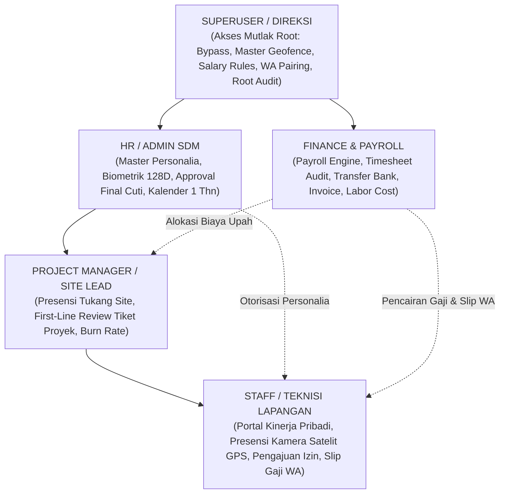
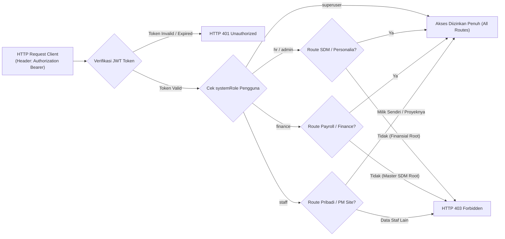
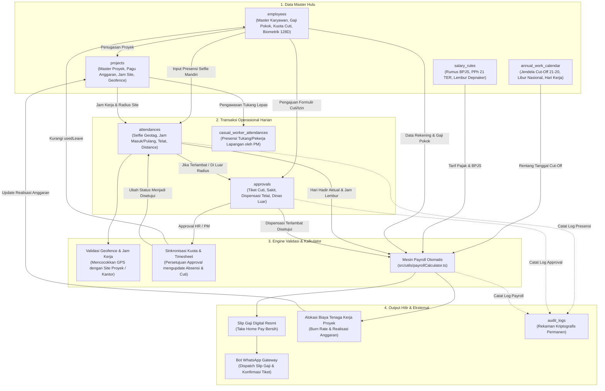
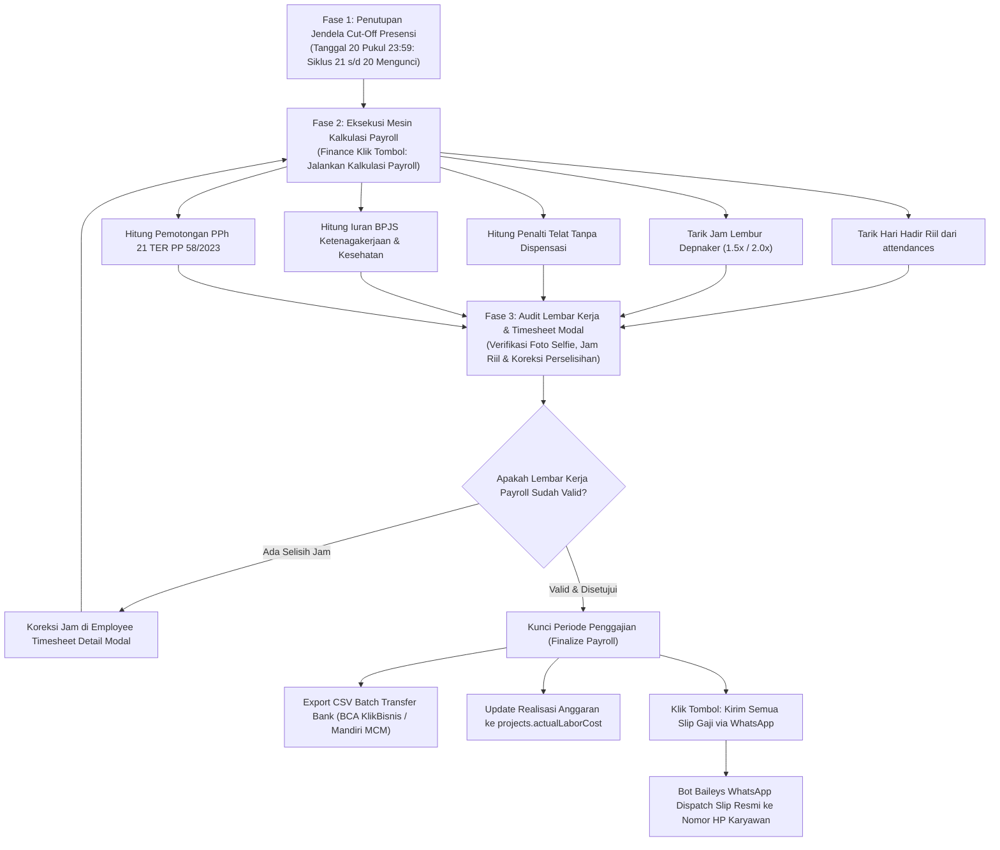

# BUKU PANDUAN PENGGUNAAN SISTEM PRIME HRIS ENTERPRISE
**Edisi:** v2.4-LTS (Dedicated Role-Based Manual & Visual Architecture Release)  
**Nomor Dokumen:** `DOC-PRIME-HRIS-MANUAL-2026-V3-SSOT`  
**Klasifikasi:** Enterprise Restricted Standard / Dokumen Operasional Resmi Korporat  
**Lead Systems Architect:** Galih Primananda (PT Prime Infinity Systems / Prime Projectx)  
**Repositori Tunggal SSOT:** `https://github.com/PrimeFox59/prime-hris.git`  

---

## DAFTAR ISI LENGKAP & TERSTRUKTUR

- [LEMBAR PENGESAHAN ARSITEKTUR DIGITAL & PENGENDALIAN MUTU](#lembar-pengesahan-arsitektur-digital--pengendalian-mutu)
- [BAB I: ARSITEKTUR DASAR SISTEM & PENJELASAN MENDALAM RBAC 5-TIER](#bab-i-arsitektur-dasar-sistem--penjelasan-mendalam-rbac-5-tier)
  - [1.1 Filosofi Zero Manual System](#11-filosofi-zero-manual-system)
  - [1.2 Pilar Arsitektur Edge-Cloud Hybrid](#12-pilar-arsitektur-edge-cloud-hybrid)
  - [1.3 Penjelasan Konsep & Hirarki RBAC 5-Tier](#13-penjelasan-konsep--hirarki-rbac-5-tier)
  - [1.4 Tabel 1.1: Matriks Otorisasi Modul & Menu Sistem (25 Fitur vs 5 Peran)](#14-tabel-11-matriks-otorisasi-modul--menu-sistem-menu-to-role-matrix---25-fitur)
  - [1.5 Tabel 1.2: Matriks Akses Data Sensitif & Finansial (Data Confidentiality Matrix)](#15-tabel-12-matriks-akses-data-sensitif--finansial-data-confidentiality-matrix)
  - [1.6 Tabel 1.3: Matriks Hirarki Otorisasi Persetujuan (Approval & Disposition Hierarchy)](#16-tabel-13-matriks-hirarki-otorisasi-persetujuan-approval--disposition-hierarchy)
  - [1.7 Tabel 1.4: Matriks Proteksi API Backend Server (server/index.js & server/db.js)](#17-tabel-14-matriks-proteksi-api-backend-server-serverindexjs--serverdbjs)
- [BAB II: STRUKTUR DATA, SILSILAH ENTITAS & PETA KETERKAITAN DATA (DATA LINEAGE)](#bab-ii-struktur-data-silsilah-entitas--peta-keterkaitan-data-data-lineage)
  - [2.1 Peta Topologi Keterkaitan Data End-to-End](#21-peta-topologi-keterkaitan-data-end-to-end)
  - [2.2 Kamus Entitas Master & Transaksional Lengkap](#22-kamus-entitas-master--transaksional-lengkap)
  - [2.3 Matriks Hubungan Antar-Tabel (Dari Mana ke Mana & Fungsinya)](#23-matriks-hubungan-antar-tabel-dari-mana-ke-mana-dan-fungsinya)
  - [2.4 Matriks Ketergantungan Data & Efek Domino (Cascading Impact)](#24-matriks-ketergantungan-data--efek-domino-cascading-impact)
- [BAB III: ALUR KERJA PRESENSI LENGKAP & MULTI-METODE (HASIL REVERSE ENGINEERING)](#bab-iii-alur-kerja-presensi-lengkap--multi-metode-hasil-reverse-engineering)
  - [3.1 Diagram Alur Presensi Terkini Berbasis REA (8 Fase Operasional)](#31-diagram-alur-presensi-terkini-berbasis-rea-8-fase-operasional)
  - [3.2 Penjelasan Rinci 8 Fase Operasional Presensi](#32-penjelasan-rinci-8-fase-operasional-presensi)
  - [3.3 Skenario 1: Presensi Kamera Selfie GPS Satelit Mandiri](#33-skenario-1-presensi-kamera-selfie-gps-satelit-mandiri)
  - [3.4 Skenario 2: Presensi Tukang Lapangan / Pekerja Harian Lepas oleh PM](#34-skenario-2-presensi-tukang-lapangan--pekerja-harian-lepas-oleh-pm)
  - [3.5 Skenario 3: Terminal Kiosk Publik di Gerbang / Lobby](#35-skenario-3-terminal-kiosk-publik-di-gerbang--lobby)
  - [3.6 Skenario 4: Penugasan Dinas Luar Mendadak (Out-of-Geofence)](#36-skenario-4-penugasan-dinas-luar-mendadak-out-of-geofence)
  - [3.7 Skenario 5: Rekonsiliasi & Koreksi Timesheet Absensi oleh HR](#37-skenario-5-rekonsiliasi--koreksi-timesheet-absensi-oleh-hr)
  - [3.8 Logika Asimetris Presensi Masuk vs Pulang (Anti-Denda Pulang)](#38-logika-asimetris-presensi-masuk-vs-pulang-anti-denda-pulang)
- [BAB IV: PANDUAN KHUSUS ROLE 1 — STAFF (KARYAWAN & TEKNISI UMUM)](#bab-iv-panduan-khusus-role-1--staff-karyawan--teknisi-umum)
  - [4.1 Profil Peran & Batasan Wewenang Staff](#41-profil-peran--batasan-wewenang-staff)
  - [4.2 Detail 5 Menu Navigasi Staff (Tujuan, Komponen UI, Input & Keterkaitan)](#42-detail-5-menu-navigasi-staff-tujuan-komponen-ui-input--keterkaitan)
  - [4.3 Alur Operasional Harian Staf (Daily Workflow)](#43-alur-operasional-harian-staf-daily-workflow)
  - [4.4 Keterkaitan Data Staf ke Peran Lain (PM, HR, Finance)](#44-keterkaitan-data-staf-ke-peran-lain-pm-hr-finance)
- [BAB V: PANDUAN KHUSUS ROLE 2 — PROJECT MANAGER & SITE COORDINATOR](#bab-v-panduan-khusus-role-2--project-manager--site-coordinator)
  - [5.1 Profil Peran & Wewenang Khusus PM di Lapangan](#51-profil-peran--wewenang-khusus-pm-di-lapangan)
  - [5.2 Detail Menu Manajemen Proyek, Presensi Tukang & Otorisasi Tim](#52-detail-menu-manajemen-proyek-presensi-tukang--otorisasi-tim)
  - [5.3 Alur Kerja Harian PM di Lokasi Proyek](#53-alur-kerja-harian-pm-di-lokasi-proyek)
  - [5.4 Keterkaitan Data Proyek ke HR dan Finance (Labor Cost Allocation & Burn Rate)](#54-keterkaitan-data-proyek-ke-hr-dan-finance-labor-cost-allocation--burn-rate)
- [BAB VI: PANDUAN KHUSUS ROLE 3 — HR / ADMIN SDM](#bab-vi-panduan-khusus-role-3--hr--admin-sdm)
  - [6.1 Profil Peran & Wewenang Personalia](#61-profil-peran--wewenang-personalia)
  - [6.2 Detail 9 Menu Navigasi HR (Master Karyawan, Biometrik 128D, Approval, Kalender)](#62-detail-9-menu-navigasi-hr-master-karyawan-biometrik-128d-approval-kalender)
  - [6.3 Siklus Bulanan & Tata Kelola Kuota Cuti / Roster](#63-siklus-bulanan--tata-kelola-kuota-cuti--roster)
  - [6.4 Keterkaitan Data HR terhadap Payroll Finance & Legal Ketenagakerjaan](#64-keterkaitan-data-hr-terhadap-payroll-finance--legal-ketenagakerjaan)
- [BAB VII: PANDUAN KHUSUS ROLE 4 — FINANCE & PAYROLL SPECIALIST](#bab-vii-panduan-khusus-role-4--finance--payroll-specialist)
  - [7.1 Profil Peran & Otoritas Keuangan Perusahaan](#71-profil-peran--otoritas-keuangan-perusahaan)
  - [7.2 Detail 9 Menu Navigasi Finance (Payroll, Bank Transfer, Invoice, Labor Cost)](#72-detail-9-menu-navigasi-finance-payroll-bank-transfer-invoice-labor-cost)
  - [7.3 Siklus Tutup Buku Penggajian Bulanan Step-by-Step (Jendela Cut-Off 21-20)](#73-siklus-tutup-buku-penggajian-bulanan-step-by-step-jendela-cut-off-21-20)
  - [7.4 Panduan Detail Tombol-Tombol Aksi pada Modul Payroll](#74-panduan-detail-tombol-tombol-aksi-pada-modul-payroll)
  - [7.5 Keterkaitan Data Finansial ke Anggaran Proyek & Distribusi Slip WhatsApp](#75-keterkaitan-data-finansial-ke-anggaran-proyek--distribusi-slip-whatsapp)
- [BAB VIII: PANDUAN KHUSUS ROLE 5 — SUPERUSER & MANAJEMEN DIREKSI](#bab-viii-panduan-khusus-role-5--superuser--manajemen-direksi)
  - [8.1 Profil Peran & Wewenang Eksekutif Root](#81-profil-peran--wewenang-eksekutif-root)
  - [8.2 Detail Menu Dashboard Terpadu, Setting Geofence & Aturan Gaji](#82-detail-menu-dashboard-terpadu-setting-geofence--aturan-gaji)
  - [8.3 Prosedur Emergency Recovery, Backup Database & Audit Trail Kriptografis](#83-prosedur-emergency-recovery-backup-database--audit-trail-kriptografis)
- [BAB IX: FORMULA PERHITUNGAN MATEMATIS & ATURAN BISNIS FINANSIAL](#bab-ix-formula-perhitungan-matematis--aturan-bisnis-finansial)
  - [9.1 Formula Lembur Depnaker RI (PP 35/2021)](#91-formula-lembur-depnaker-ri-pp-352021)
  - [9.2 Formula Denda Keterlambatan Bertingkat & Grace Period](#92-formula-denda-keterlambatan-bertingkat--grace-period)
  - [9.3 Formula BPJS Ketenagakerjaan & Kesehatan](#93-formula-bpjs-ketenagakerjaan--kesehatan)
  - [9.4 Formula PPh 21 TER (PP 58/2023)](#94-formula-pph-21-ter-pp-582023)
  - [9.5 Formula Pembebanan Biaya Tenaga Kerja ke Proyek (Labor Cost Allocation)](#95-formula-pembebanan-biaya-tenaga-kerja-ke-proyek-labor-cost-allocation)
- [BAB X: PANDUAN INTEGRASI ENGINE OTOMATIS & BACKEND SERVICES](#bab-x-panduan-integrasi-engine-otomatis--backend-services)
  - [10.1 WhatsApp Bot Baileys Socket & Whitelist Opt-In](#101-whatsapp-bot-baileys-socket--whitelist-opt-in)
  - [10.2 SMTP Nodemailer Gateway](#102-smtp-nodemailer-gateway)
  - [10.3 Engine AI Wajah FaceNet ResNet-34 128D & Anti-Spoofing](#103-engine-ai-wajah-facenet-resnet-34-128d--anti-spoofing)
- [BAB XI: TROUBLESHOOTING MANDIRI BERDASARKAN PERAN & FAQ](#bab-xi-troubleshooting-mandiri-berdasarkan-peran--faq)
  - [11.1 Matriks Solusi Masalah untuk Staf Lapangan](#111-matriks-solusi-masalah-untuk-staf-lapangan)
  - [11.2 Matriks Solusi Masalah untuk PM & HR Admin](#112-matriks-solusi-masalah-untuk-pm--hr-admin)
  - [11.3 Matriks Solusi Masalah untuk Finance & IT Superuser](#113-matriks-solusi-masalah-untuk-finance--it-superuser)
  - [11.4 FAQ Komprehensif](#114-faq-komprehensif)
- [BAB XII: DAFTAR ISTILAH & GLOSARIUM ENTERPRISE](#bab-xii-daftar-istilah--glosarium-enterprise)

---

## LEMBAR PENGESAHAN ARSITEKTUR DIGITAL & PENGENDALIAN MUTU

Sesuai Kebijakan Rekayasa Sistem Prime Projectx, dokumen manual operasional ini merupakan **System-Automated Digital Enterprise Report**. Seluruh isi dokumen ini, termasuk logika bisnis presensi, formulasi matematis payroll, matriks otorisasi RBAC, hingga skema relasi basis data, diverifikasi secara langsung terhadap basis kode produksi aktif pada repositori `https://github.com/PrimeFox59/prime-hris.git`.

> [!NOTE]
> **Prinsip Pemisahan Buku Panduan Per Peran (Role Separation):**
> Untuk mencegah kebingungan pengguna di lapangan, buku panduan ini membagi panduan operasional ke dalam bab-bab khusus independen untuk setiap peran (Staff, Project Manager, HR, Finance, Superuser). Pengguna hanya perlu membaca bab yang sesuai dengan perannya masing-masing untuk memahami seluruh tugas, fungsi tombol, input data, dan keterkaitan data yang dihasilkannya.

---

## BAB I: ARSITEKTUR DASAR SISTEM & PENJELASAN MENDALAM RBAC 5-TIER

### 1.1 Filosofi Zero Manual System
PRIME HRIS Enterprise dibangun dengan visi tunggal: **Zero Manual System**. Seluruh gesekan operasional yang lazim memperlambat produktivitas perusahaan manufaktur, kontraktor, dan multi-cabang dieliminasi melalui otomatisasi cerdas:
- **Eliminasi Kertas Presensi:** Tidak ada lagi pencatatan presensi fisik atau lembaran absensi kertas yang rentan hilang, tercecer, atau dimanipulasi.
- **Eliminasi Rekapitulasi Spreadsheet Berhari-Hari:** Mesin payroll otomatis mengolah data presensi real-time dari database SQLite WAL tanpa perlu rekap manual berhari-hari menjelang tanggal gajian.
- **Eliminasi Perselisihan Lembur & Keterlambatan:** Perhitungan denda dan lembur diproses transparan berdasarkan formula baku Depnaker RI (PP 35/2021).
- **Eliminasi Distribusi Slip Fisik:** Bot WhatsApp mandiri mengirimkan rincian slip gaji resmi secara digital ke nomor ponsel masing-masing staf dalam hitungan detik.

### 1.2 Pilar Arsitektur Edge-Cloud Hybrid
Sistem beroperasi di atas 4 pilar arsitektur teknologi berkinerja tinggi:
1. **Frontend Responsif Multi-Platform:** Dibangun menggunakan React 18, TypeScript, Tailwind CSS, Lucide Icons, dan Apache ECharts. Menerapkan caching cerdas lokal sehingga pengguna tetap dapat bernavigasi cepat meskipun koneksi internet di lokasi proyek mengalami fluktuasi sinyal.
2. **Runtime Backend Node.js Berkecepatan Tinggi:** Server HTTP mandiri berbasis Node.js yang dilengkapi kompresi GZIP otomatis, transmisi Server-Sent Events (SSE) untuk pembaruan data real-time, dan pemrosesan asinkronus tanpa blocking.
3. **Basis Data SQLite 3 Native Berbasis WAL:** Menggunakan engine native SQLite 3 (`node:sqlite`) yang dikonfigurasi dengan Write-Ahead Logging (WAL) dan `PRAGMA synchronous = NORMAL`. Menghasilkan kecepatan baca/tulis mikrodetik, bebas ketergantungan koneksi jaringan database eksternal, dan kebal dari kerusakan data saat pemadaman listrik mendadak.
4. **WhatsApp Gateway Mandiri:** Engine Baileys multi-device socket yang terhubung langsung ke WhatsApp Web tanpa vendor perantara berbayar pihak ketiga untuk mendistribusikan slip gaji dan tiket persetujuan seketika.

### 1.3 Penjelasan Konsep & Hirarki RBAC 5-Tier
Untuk menjamin integritas data korporat dan menerapkan prinsip pemisahan wewenang (*Segregation of Duties*), sistem membagi otorisasi ke dalam 5 tingkatan peran formal:
1. **`staff` (Umum / Teknisi):** Karyawan kantor, operator workshop, dan teknisi lapangan.
2. **`staff` (Project Manager):** Site Manager, Site Coordinator, atau Mandor Lapangan yang memimpin penugasan tim di lokasi proyek.
3. **`hr` / `admin`:** HR Manager, Supervisor Personalia, dan Admin SDM yang mengelola master personalia dan kalender kerja.
4. **`finance`:** Finance Manager, Payroll Specialist, dan Bagian Keuangan yang mengelola penggajian, perbankan, dan penagihan invoice.
5. **`superuser`:** Direktur Utama, Technical Lead, dan Lead Systems Architect dengan wewenang bypass dan kontrol root.

### 1.4 Tabel 1.1: Matriks Otorisasi Modul & Menu Sistem (Menu-to-Role Matrix - 25 Fitur)

> **Keterangan Indikator Hak Akses:**
> - 🟢 **FULL (CRUD):** Akses Penuh (*Create, Read, Update, Delete* / Eksekusi).
> - 🔵 **READ ONLY:** Hanya dapat melihat data secara menyeluruh tanpa wewenang mengubah.
> - 🟡 **SELF ONLY:** Terbatas hanya untuk data pribadi dirinya sendiri (*Read & Submit*).
> - 🟠 **PROJECT ONLY:** Terbatas hanya untuk proyek site yang dipimpinnya.
> - 🔴 **NO ACCESS:** Menu tersembunyi (*hidden*) & akses API diblokir (*HTTP 403 Forbidden*).

| No | Modul / Sub-Modul Sistem | Staff (Umum) | Project Manager | HR / Admin SDM | Finance & Payroll | Superuser / Direksi |
| :---: | :--- | :---: | :---: | :---: | :---: | :---: |
| **1** | **Portal Kinerja Saya** (`dashboard`) | 🟡 Self Only | 🟡 Self Only | 🔵 Read Only | 🔵 Read Only | 🟢 FULL (CRUD) |
| **2** | **Dashboard HRIS & SDM** (`dashboard`) | 🔴 No Access | 🔴 No Access | 🟢 FULL (CRUD) | 🔵 Read Only | 🟢 FULL (CRUD) |
| **3** | **Dashboard Keuangan & Finance** (`dashboard`) | 🔴 No Access | 🔴 No Access | 🔴 No Access | 🟢 FULL (CRUD) | 🟢 FULL (CRUD) |
| **4** | **Executive Dashboard Terpadu** (`dashboard`) | 🔴 No Access | 🔴 No Access | 🔴 No Access | 🔴 No Access | 🟢 FULL (CRUD) |
| **5** | **Presensi Kamera Saya** (`attendance`) | 🟡 Self Only | 🟡 Self Only | 🟡 Self Only | 🟡 Self Only | 🟢 FULL (Test/Any) |
| **6** | **Audit Rekap Presensi & Jam Kerja** (`attendance`) | 🔴 No Access | 🟠 Project Only | 🟢 FULL (CRUD) | 🔵 Read Only (Payroll) | 🟢 FULL (CRUD) |
| **7** | **Pengajuan & Izin Saya** (`approvals`) | 🟡 Self Only | 🟡 Self Only | 🟡 Self Only | 🟡 Self Only | 🟢 FULL (CRUD) |
| **8** | **Pusat Approval SDM (Final)** (`approvals`) | 🔴 No Access | 🔴 No Access | 🟢 FULL (Final) | 🔵 Read Only | 🟢 FULL (Bypass) |
| **9** | **Otorisasi Anggota Proyek** (`approvals`) | 🔴 No Access | 🟠 Project Only | 🟢 FULL (CRUD) | 🔴 No Access | 🟢 FULL (CRUD) |
| **10** | **Presensi Tukang Lapangan** (`casual_attendance`) | 🔴 No Access | 🟠 Project (Input) | 🔵 Read (Audit) | 🔵 Read (Kas) | 🟢 FULL (CRUD) |
| **11** | **Manajemen Proyek & Site** (`projects`) | 🔴 No Access | 🟠 Project Only | 🟢 FULL (Alokasi) | 🔵 Read Only | 🟢 FULL (CRUD) |
| **12** | **Kontrol Biaya Tenaga Kerja** (`projects`) | 🔴 No Access | 🟠 Project (Burn Rate) | 🔴 No Access | 🟢 FULL (Alokasi) | 🟢 FULL (CRUD) |
| **13** | **Master Data Karyawan** (`users`) | 🔴 No Access | 🔴 No Access | 🟢 FULL (CRUD) | 🔴 No Access | 🟢 FULL (CRUD) |
| **14** | **Pendaftaran Biometrik Wajah AI** (`users`) | 🔴 No Access | 🔴 No Access | 🟢 FULL (Enroll) | 🔴 No Access | 🟢 FULL (CRUD) |
| **15** | **Master Data Gaji & Rekening** (`users`) | 🔴 No Access | 🔴 No Access | 🔵 Read Only | 🟢 FULL (CRUD) | 🟢 FULL (CRUD) |
| **16** | **Kalkulator Payroll Bulanan** (`payroll`) | 🔴 No Access | 🔴 No Access | 🔴 No Access | 🟢 FULL (Hitung/Kunci) | 🟢 FULL (CRUD) |
| **17** | **Slip Gaji Saya (Personal Slip)** (`payroll`) | 🟡 Self Only | 🟡 Self Only | 🟡 Self Only | 🟡 Self Only | 🟢 FULL (Lihat Semua) |
| **18** | **Ekspor Transfer Bank & WA Dispatch** (`payroll`) | 🔴 No Access | 🔴 No Access | 🔴 No Access | 🟢 FULL (Ekspor/Kirim) | 🟢 FULL (CRUD) |
| **19** | **Koreksi Timesheet HR** (`EmployeeTimesheetModal`) | 🔴 No Access | 🔴 No Access | 🟢 FULL (Koreksi) | 🟢 FULL (Audit Gaji) | 🟢 FULL (CRUD) |
| **20** | **Kalender Kerja & Cut-Off 1 Thn** (`work_calendar`) | 🔴 No Access | 🔴 No Access | 🟢 FULL (Setting) | 🔵 Read (Verifikasi) | 🟢 FULL (CRUD) |
| **21** | **Invoice Resmi Termin Klien** (`invoice`) | 🔴 No Access | 🔴 No Access | 🔴 No Access | 🟢 FULL (Billing) | 🟢 FULL (CRUD) |
| **22** | **Setting WhatsApp Bot Baileys** (`system_settings`) | 🔴 No Access | 🔴 No Access | 🔵 Read (Opt-In) | 🔴 No Access | 🟢 FULL (Pair QR) |
| **23** | **Setting Geofence & SMTP Mail** (`system_settings`) | 🔴 No Access | 🔴 No Access | 🔴 No Access | 🔴 No Access | 🟢 FULL (CRUD) |
| **24** | **Audit Trail Kriptografis** (`audit`) | 🔴 No Access | 🔴 No Access | 🔵 Read (SDM) | 🔵 Read (Finance) | 🟢 FULL (Root Log) |
| **25** | **Terminal Kiosk Publik** (`?tab=kiosk`) | 🟢 Publik/PIN | 🟢 Publik/PIN | 🟢 Publik/PIN | 🟢 Publik/PIN | 🟢 FULL (Setup) |

### 1.5 Tabel 1.2: Matriks Akses Data Sensitif & Finansial (Data Confidentiality Matrix)

Tabel berikut menjamin kepatuhan perlindungan data pribadi (*Data Privacy*) dan menjaga kerahasiaan komersial perusahaan agar parameter finansial maupun biometrik hanya dapat diakses oleh personil yang berhak:

| Objek Data Sensitif & Kritis | Staff (Umum) | Project Manager | HR / Admin SDM | Finance & Payroll | Superuser / Direksi |
| :--- | :---: | :---: | :---: | :---: | :---: |
| **Gaji Pokok & Tunjangan Staf Lain** | 🔴 Dilarang | 🔴 Dilarang | 🔵 Terbatas SDM | 🟢 Akses Penuh | 🟢 Akses Penuh |
| **Nomor Rekening Bank Staf Lain** | 🔴 Dilarang | 🔴 Dilarang | 🔵 Terbatas Verifikasi | 🟢 Akses Penuh (Transfer) | 🟢 Akses Penuh |
| **Pagu Anggaran Kontrak Klien** | 🔴 Dilarang | 🟠 Anggaran Upah Saja | 🔴 Dilarang | 🟢 Akses Penuh | 🟢 Akses Penuh |
| **Realisasi Serapan Anggaran Upah** | 🔴 Dilarang | 🟠 Proyek Terkait | 🔴 Dilarang | 🟢 Akses Penuh (EAC) | 🟢 Akses Penuh |
| **Potongan PPh 21 TER & Iuran BPJS** | 🟡 Milik Sendiri | 🟡 Milik Sendiri | 🔴 Dilarang | 🟢 Rekapitulasi Pajak | 🟢 Akses Penuh |
| **Vektor Biometrik Wajah 128D** | 🔴 Terenkripsi | 🔴 Terenkripsi | 🟢 Pendaftaran Ulang | 🔴 Dilarang | 🟢 Akses Penuh |
| **Kredensial Akun & Password Hash** | 🔴 Dilarang | 🔴 Dilarang | 🟢 Reset Sandi Default | 🔴 Dilarang | 🟢 Akses Root |
| **Alamat IP & Forensik Audit Trail** | 🔴 Dilarang | 🔴 Dilarang | 🔵 Mutasi Personalia | 🔵 Mutasi Penggajian | 🟢 Seluruh Jejak Audit |

### 1.6 Tabel 1.3: Matriks Hirarki Otorisasi Persetujuan (Approval & Disposition Hierarchy)

Menjabarkan alur persetujuan tiket secara berjenjang dari inisiator pemohon hingga validasi dan eksekusi otomatis sistem:

| Jenis Tiket / Permohonan | Pemohon (*Initiator*) | Pemeriksa Awal (*Reviewer*) | Pemutus Akhir (*Final Approver*) | Dampak Otomatis Sistem |
| :--- | :--- | :--- | :--- | :--- |
| **Cuti Tahunan Reguler** | Karyawan Kantor | — (Langsung HR) | **HR Manager** | Memotong saldo `leaveQuota`, status kalender absensi menjadi `LEAVE`. |
| **Cuti Roster Non-Lokal (Site)** | Teknisi Lapangan | **Project Manager (PM)** | **HR Manager** | Penyesuaian jadwal roster site, proteksi akumulasi cuti periode berikutnya. |
| **Izin Sakit / Surat Dokter** | Seluruh Karyawan | — | **HR Manager** | Status absensi menjadi `SICK`, tunjangan kehadiran disesuaikan tanpa denda. |
| **Dispensasi Terlambat** | Seluruh Karyawan | **PM** (Site) / — (Kantor) | **HR Manager** | Denda keterlambatan pada mesin payroll dibatalkan (*Late Penalty Waived*). |
| **Penugasan Dinas Luar** | Staf Kantor / Site | Atasan Langsung / **PM** | **HR Manager** | Presensi luar radius diakui sah, status absensi menjadi `DINAS_LUAR`. |
| **Koreksi Absensi Mandiri** | Karyawan | — | **HR Manager** | Mengubah jam check-in/out di `attendances`, memicu audit log koreksi. |
| **Koreksi Timesheet oleh HR** | HRD / Finance | — | **HR Manager** | Override jam masuk/pulang pada *Employee Timesheet Detail Modal*. |
| **Presensi Tukang Lapangan** | Mandor Proyek | — | **Project Manager (PM)** | Memvalidasi kehadiran tukang site, dasar pencairan kas operasional proyek. |
| **Finalisasi Payroll Bulanan** | Mesin Payroll | **Payroll Specialist** | **Finance Manager / Direksi** | Mengunci lembar gaji, cetak slip PDF, ekspor batch bank, dan kirim WA. |

### 1.7 Tabel 1.4: Matriks Proteksi API Backend Server (server/index.js & server/db.js)

Setiap endpoint API pada backend Node.js diproteksi dengan otorisasi berbasis token JWT dan pemeriksaan `systemRole` pengguna:

| Rute Endpoint API | Metode HTTP | Hak Peran Minimum | Tindakan & Validasi Server |
| :--- | :---: | :---: | :--- |
| `/api/auth/login` | `POST` | *Publik* | Verifikasi PBKDF2/SHA-512 password hash + salt. Mengembalikan token JWT sesi. |
| `/api/auth/biometric-login` | `POST` | *Publik / Kiosk* | Verifikasi vektor Euclidean distance $\le 0.45$. Mengembalikan token sesi aman. |
| `/api/employees` | `GET` | `hr`, `finance`, `superuser` | Mengembalikan master data karyawan (Staf biasa dibatasi ke `/api/auth/me`). |
| `/api/employees` | `POST / PUT` | `hr`, `superuser` | Tambah/Ubah profil staf, gaji pokok, tunjangan, departemen. |
| `/api/employees/:id/biometric` | `POST / DEL` | `hr`, `superuser` | Pendaftaran vektor biometrik 128D baru atau penghapusan profil biometrik lama. |
| `/api/employees/:id/reset-password` | `POST` | `hr`, `superuser` | Reset kata sandi staf ke default aman (`zzz`) saat lupa password. |
| `/api/attendances` | `GET` | *Semua Role (Tersaring)* | Staf hanya melihat miliknya; PM melihat staf proyeknya; HR/Finance melihat semua. |
| `/api/attendances` | `POST` | *Semua Karyawan* | Input absensi mandiri. Validasi geofence Haversine meter & foto selfie. |
| `/api/approvals` | `POST` | *Semua Karyawan* | Pengajuan tiket permohonan baru oleh staf. |
| `/api/approvals/:id` | `PUT` | `pm`, `hr`, `superuser` | Eksekusi persetujuan/penolakan tiket. Memotong saldo cuti & update absensi. |
| `/api/casual-workers` | `GET / POST` | `pm`, `hr`, `superuser` | Pendaftaran dan pembacaan data pekerja harian lepas proyek. |
| `/api/casual-worker-attendances` | `POST` | `pm`, `superuser` | Pengambilan foto presensi harian tukang di site proyek dengan GPS watermark. |
| `/api/salary-rules` | `GET / POST` | `superuser` (Write), `finance` (Read) | Mengatur tarif BPJS, rumus PPh 21 TER, pengali lembur, dan geofence kantor. |
| `/api/work-calendar` | `GET / POST` | `hr`, `superuser` (Write), `finance` (Read) | Mengatur hari libur nasional, akhir pekan perusahaan, dan jendela cut-off (21-20). |
| `/api/whatsapp/send-slip` | `POST` | `finance`, `superuser` | Mengirimkan slip gaji digital via socket Baileys WhatsApp ke nomor karyawan. |
| `/api/audit-logs` | `GET` | `hr`, `finance`, `superuser` | Pembacaan log kronologis mutasi sistem (Tabel bersifat *Append-Only*). |

---

## BAB II: STRUKTUR DATA, SILSILAH ENTITAS & PETA KETERKAITAN DATA (DATA LINEAGE)

### 2.1 Peta Topologi Keterkaitan Data End-to-End
Di dalam PRIME HRIS, seluruh entitas data dirancang saling terhubung secara terstruktur tanpa redundansi:

### 2.2 Kamus Entitas Master & Transaksional Lengkap
Sistem mengelola 10 tabel utama pada basis data SQLite 3 WAL:
1. **`employees`:** Master profil seluruh tenaga kerja (NIK, Nama, Email, Nomor Telepon, Departemen, Jabatan, Gaji Pokok, Tunjangan Tetap, Kuota Cuti, Proyek Ditugaskan, Vektor Biometrik Wajah 128D, dan Password Hash).
2. **`projects`:** Master data kontrak proyek operasional (Kode Proyek, Nama Klien, Pagu Anggaran Biaya Upah, Koordinat GPS Lintang/Bujur Site, Radius Toleransi Geofence, Jam Kerja Khusus, dan ID Project Manager).
3. **`annual_work_calendar`:** Master jadwal kerja kalender 1 tahun (Jadwal Hari Kerja Efektif, Akhir Pekan Perusahaan, Hari Libur Nasional Resmi, dan Konfigurasi Jendela Cut-Off Penggajian Bulanan).
4. **`salary_rules`:** Konfigurasi parameter finansial (Tarif BPJS Ketenagakerjaan & Kesehatan, Tabel Tarif Efektif Rata-Rata PPh 21 TER, Pengali Jam Lembur Depnaker, dan Batas Toleransi Keterlambatan).
5. **`attendances`:** Transaksi absensi harian staf (Jam Masuk, Jam Pulang, Foto Selfie Ber-watermark, Koordinat Satelit GPS, Alamat Fisik Geocoded, Status Kehadiran, Menit Keterlambatan, dan Catatan Luar Area).
6. **`approvals`:** Buku besar permohonan dan tiket persetujuan berjenjang (Tiket Cuti Tahunan, Cuti Roster Site, Dispensasi Terlambat, Izin Sakit, Penugasan Dinas Luar, Rekomendasi PM, dan Otorisasi Final HR).
7. **`casual_workers`:** Master daftar pekerja harian lepas / tukang di lokasi proyek tanpa akun login mandiri.
8. **`casual_worker_attendances`:** Log harian pencatatan kehadiran tukang yang difoto langsung oleh Project Manager di lapangan beserta geotag watermark GPS.
9. **`wa_notifications`:** Antrean dan arsip pesan notifikasi slip gaji dan tiket persetujuan yang dikirimkan via Baileys WhatsApp socket.
10. **`audit_logs`:** Buku besar jejak audit kriptografis yang bersifat *Append-Only* untuk merekam setiap aksi mutasi sistem demi kepatuhan forensik korporat.

### 2.3 Matriks Hubungan Antar-Tabel (Dari Mana ke Mana dan Fungsinya)

| Tabel Asal & Kunci | Tabel Tujuan (Relasi) | Arah Aliran & Kardinalitas | Fungsi Bisnis & Dampak Operasional |
| :--- | :--- | :--- | :--- |
| `employees.id` | `attendances.employeeId` | `employees` $\rightarrow$ `attendances` (1 : N) | Mengikat setiap transaksi absensi harian (jam masuk/pulang, foto, koordinat) ke identitas karyawan pemilik data. |
| `employees.assignedProjectId` | `projects.id` | `employees` $\rightarrow$ `projects` (N : 1) | Menentukan di proyek mana staf bertugas. Menentukan aturan jam kerja khusus site dan radius toleransi GPS proyek. |
| `attendances.id` | `approvals.attendanceRecordId` | `attendances` $\rightarrow$ `approvals` (1 : 1) | Jika presensi berstatus terlambat (`LATE`) atau di luar geofence, sistem mengaitkan tiket dispensasi ke rekaman absensi terkait. |
| `approvals.employeeId` | `employees.id` | `approvals` $\rightarrow$ `employees` (N : 1) | Tiket permohonan cuti tahunan yang disetujui HR secara seketika memotong saldo `employees.leaveQuota` dan menambah `usedLeave`. |
| `projects.id` | `casual_workers.projectId` | `projects` $\rightarrow$ `casual_workers` (1 : N) | Mengelompokkan daftar tukang harian lepas yang bekerja pada kontrak proyek tertentu di bawah pengawasan PM. |
| `attendances` + `approvals` | `payrollCalculator` Engine | `attendances` $\rightarrow$ `Payroll` $\rightarrow$ `projects` | Menjadi bahan baku penghitungan hari hadir riil, jam lembur Depnaker, dan pembebanan biaya upah ke anggaran proyek. |
| `payrollCalculator` | `wa_notifications.recipient_phone` | `Payroll` $\rightarrow$ `wa_notifications` $\rightarrow$ WhatsApp | Memicu bot WhatsApp mengirimkan rincian slip gaji resmi secara digital ke nomor ponsel masing-masing staf. |

### 2.4 Matriks Ketergantungan Data & Efek Domino (Cascading Impact)
Sistem PRIME HRIS menerapkan prinsip dependensi data berantai (*Cascading Impact*):
1. **Efek Domino Perubahan Jadwal Shift:** Jika HR mengubah `userSchedule.cutoffTime` di `annual_work_calendar`, aturan evaluasi keterlambatan saat staf menekan tombol Presensi Masuk seketika menyesuaikan dengan jam baru.
2. **Efek Domino Approval Tiket:** Ketika tiket dispensasi keterlambatan (`APP-LATE`) disetujui HR, mesin payroll secara otomatis membatalkan potongan denda (*Late Penalty Waived*). Karyawan menerima tunjangan kehadiran secara penuh.
3. **Efek Domino Kunci Payroll:** Saat Finance menekan tombol *Finalisasi Payroll*, status lembar gaji mengunci permanen, data kompensasi lembur ditutup, dan serapan anggaran upah langsung dibebankan ke `projects.actualLaborCost`.

---

## BAB III: ALUR KERJA PRESENSI LENGKAP & MULTI-METODE (HASIL REVERSE ENGINEERING)

### 3.1 Diagram Alur Presensi Terkini Berbasis REA (8 Fase Operasional)
Berdasarkan investigasi kode sumber riil (*Reverse-Engineer-Anything*) pada `src/components/PresensiCameraTab.tsx` dan `src/App.tsx`, berikut adalah diagram graf alur presensi aktual sistem:

```mermaid
graph TD
    subgraph FASE_1 ["1. AUTENTIKASI PENGGUNA (LOGIN GATEWAY)"]
        START(["Pengguna Membuka Aplikasi PRIME HRIS"]) --> LOGIN_TYPE{"Pilih Moda Login"}
        LOGIN_TYPE -->|"Moda 1: Kredensial"| PASS_AUTH["Input NIK / Email / Username & Sandi PBKDF2"]
        LOGIN_TYPE -->|"Moda 2: Face ID 1:N"| FACE_AUTH["Scan Wajah via Kamera (Fast Gallery < 80 KB)"]
        LOGIN_TYPE -->|"Moda 3: Kiosk Publik"| KIOSK_AUTH["Portal Kiosk Gerbang (?tab=kiosk + PIN 4-Digit)"]
        PASS_AUTH --> API_LOGIN{"POST /api/auth/login"}
        FACE_AUTH --> API_FACE{"POST /api/auth/biometric-login"}
        KIOSK_AUTH --> API_KIOSK{"POST /api/public-attendance"}
        API_LOGIN -->|"Valid"| SET_JWT["Simpan prime_hris_token ke LocalStorage & Muat currentUser"]
        API_FACE -->|"Valid"| SET_JWT
    end
    subgraph FASE_2 ["2. INISIALISASI & PENGUNCIAN LOKASI KERJA (ZERO AUTO-DETECT)"]
        SET_JWT --> OPEN_TAB["Buka Tab Presensi Kamera Saya"]
        OPEN_TAB --> SYNC_TIME["1. Ambil Waktu Server (rtcService.getServerNow)<br/>2. Deteksi Jam >= 12:00 ? Default CHECK_OUT : CHECK_IN"]
        SYNC_TIME --> LOCK_TARGET["Kunci Target Lokasi Resmi Karyawan:<br/>assignedProject = currentUser.assignedProjectId || OFFICE<br/>(Tanpa Tebak-Tebakan Proyek Terdekat)"]
    end
    subgraph FASE_3 ["3. VERIFIKASI SENSOR PERANGKAT KERAS (HARD GATE)"]
        LOCK_TARGET --> TRIGGER_GPS["Eksekusi fetchDeviceGps(enableHighAccuracy: true)"]
        TRIGGER_GPS --> EVAL_GPS{"Apakah Hardware GPS Terkunci?"}
        EVAL_GPS -->|"TIDAK / Izin Ditolak"| GPS_DEAD["isGpsLocked = FALSE<br/>Tombol Submit Berstatus DISABLED<br/>Alert: GPS Wajib Aktif untuk Presensi"]
        EVAL_GPS -->|"YA (Sinyal Satelit Valid)"| GPS_LOCKED["isGpsLocked = TRUE<br/>Dapatkan Koordinat Riil (Lat, Lng, Accuracy Meter)"]
        GPS_LOCKED --> INIT_CAM["Buka Video Stream Kamera (getUserMedia ideal: 640x480)"]
    end
    subgraph FASE_4 ["4. PEMILIHAN AKSI & EVALUASI GEOFENCE HAVERSINE"]
        INIT_CAM --> CHOOSE_ACTION{"Pengguna Memilih Aksi"}
        CHOOSE_ACTION -->|"Klik Tombol Hijau"| ACT_CHECKIN["Aksi: PRESENSI MASUK (CHECK_IN)<br/>Evaluasi Jadwal Masuk (userSchedule.cutoffTime)"]
        CHOOSE_ACTION -->|"Klik Tombol Biru"| ACT_CHECKOUT["Aksi: PRESENSI PULANG (CHECK_OUT)<br/>Auto-Set: isLate = false, lateMinutes = 0"]
        ACT_CHECKIN --> CALC_GEO["Hitung Jarak Fisik ke Lokasi Target Resmi (Haversine Formula)"]
        ACT_CHECKOUT --> CALC_GEO
        CALC_GEO --> GEO_CHECK{"Jarak <= Radius Geofence (350m / Site Radius)?"}
        GEO_CHECK -->|"Ya (Dalam Radius)"| GEO_PASS["inGeofence = TRUE<br/>Status: ON_TIME / PRESENT"]
        GEO_CHECK -->|"Tidak (Luar Radius)"| GEO_FAIL["inGeofence = FALSE<br/>Status: OUT_OF_GEOFENCE<br/>Wajib Isi Form Alasan Luar Area"]
    end
    subgraph FASE_5 ["5. CAPTURE FOTO & EVALUASI BISNIS MASUK / PULANG"]
        GEO_PASS --> CLICK_SUBMIT["Pengguna Menekan Tombol Submit Presensi"]
        GEO_FAIL --> CLICK_SUBMIT
        CLICK_SUBMIT --> SNAP_PHOTO["HTML5 Canvas Mengambil Snapshot JPEG Resolusi Penuh"]
        SNAP_PHOTO --> EVAL_BRANCH{"Pemeriksaan Cabang Aksi"}
        EVAL_BRANCH -->|"Aksi = CHECK_IN"| CHECK_LATE{"Waktu Sekarang > Cutoff (08:15)?"}
        CHECK_LATE -->|"Tepat Waktu"| REC_ONTIME["isLate = false<br/>lateMinutes = 0<br/>Status = ON_TIME"]
        CHECK_LATE -->|"Terlambat"| REC_LATE["isLate = true<br/>lateMinutes = Math.floor(diffMs / 60000)<br/>Fallback Alasan: Penumpukan arus lalu lintas"]
        EVAL_BRANCH -->|"Aksi = CHECK_OUT"| CHECK_EXISTING{"Cari Rekam Masuk Hari Ini (existingToday)?"}
        CHECK_EXISTING -->|"Ada Rekam Masuk"| MERGE_RECORD["Satukan ke Record Hari Ini:<br/>ID: existingToday.id<br/>checkInTime: Dipertahankan<br/>checkOutTime: Jam Sekarang<br/>isLate = false"]
        CHECK_EXISTING -->|"Belum Ada Masuk"| STANDALONE_OUT["Catat Baris Baru Check-Out<br/>(Flag Investigasi Koreksi HR)"]
    end
    subgraph FASE_6 ["6. PERSISTENSI DATABASE & GENERASI TIKET APPROVAL OTOMATIS"]
        REC_ONTIME --> DISPATCH_DATA["Kirim Payload ke api.saveAttendance(record)"]
        REC_LATE --> DISPATCH_DATA
        MERGE_RECORD --> DISPATCH_DATA
        STANDALONE_OUT --> DISPATCH_DATA
        DISPATCH_DATA --> DB_SQLITE["Simpan ke SQLite WAL (Tabel attendances) & Update State App"]
        DB_SQLITE --> CHECK_AUTO_APP{"Evaluasi Pemicu Tiket Persetujuan di App.tsx"}
        CHECK_AUTO_APP -->|"inGeofence == false"| TRIGGER_APP_GEO["Auto-Create Ticket: APP-GEO<br/>Target: PM Proyek / HR Manager"]
        CHECK_AUTO_APP -->|"isLate == true & CHECK_IN"| TRIGGER_APP_LATE["Auto-Create Ticket: APP-LATE<br/>Target: PM Proyek / HR Manager (Dispensasi Denda)"]
        CHECK_AUTO_APP -->|"mode == DINAS_LUAR"| TRIGGER_APP_DINAS["Auto-Create Ticket: APP-DINAS<br/>Target: PM Proyek / HR Manager"]
        CHECK_AUTO_APP -->|"Normal On-Time"| NO_TICKET["approvalStatus: NOT_REQUIRED"]
        TRIGGER_APP_GEO --> DISPATCH_WA["Kirim Konfirmasi Tiket & Presensi via WhatsApp Baileys"]
        TRIGGER_APP_LATE --> DISPATCH_WA
        TRIGGER_APP_DINAS --> DISPATCH_WA
        NO_TICKET --> DISPATCH_WA
        DISPATCH_WA --> LIVE_BROADCAST["Broadcast Live Update via SSE ke Dashboard HR/PM & Catat Audit Log"]
    end
```

### 3.2 Penjelasan Rinci 8 Fase Operasional Presensi
1. **Fase 1 (Login Gateway):** Pengguna masuk menggunakan salah satu dari 3 moda aman: Kredensial akun, pengenalan wajah Face ID 1:N, atau terminal Kiosk gerbang publik. Sesi menghasilkan token JWT aman.
2. **Fase 2 (Inisialisasi & Penguncian Lokasi):** Sistem menyinkronkan jam server melalui `rtcService.getServerNow()` untuk mencegah manipulasi jam HP lokal. Lokasi kerja target dikunci secara ketat ke `currentUser.assignedProjectId`.
3. **Fase 3 (Verifikasi Sensor Hardware):** Browser meminta izin sensor GPS satelit (`enableHighAccuracy: true`). Jika GPS mati, tombol kirim otomatis berstatus `disabled` dan presensi ditolak (*Zero Fake Submission*).
4. **Fase 4 (Pemilihan Aksi & Geofence):** Pengguna memilih tombol hijau *Presensi Masuk* atau tombol biru *Presensi Pulang*. Sistem menghitung jarak fisik riil menggunakan rumus trigonometri bola bumi Haversine terhadap target resmi.
5. **Fase 5 (Snapshot Foto & AI FaceNet):** Kanvas merekam foto selfie ber-watermark dan mencocokkan vektor biometrik 128D dengan threshold Euclidean $\le 0.45$.
6. **Fase 6 (Evaluasi Aturan Jam Kerja):** Jika aksi adalah `CHECK_IN` dan waktu melewati batas cutoff (08:15), sistem menghitung menit terlambat dan mewajibkan alasan. Jika aksi adalah `CHECK_OUT`, sistem secara otomatis menonaktifkan status terlambat (`isLate = false`).
7. **Fase 7 (Persistensi & Merging):** Record absensi pulang disatukan dengan absensi masuk hari ini (`existingToday.id`) dan disimpan ke tabel `attendances` SQLite WAL.
8. **Fase 8 (Tiket Otomatis & Notifikasi):** Jika absensi terlambat atau berada di luar geofence, sistem otomatis menerbitkan tiket persetujuan di tabel `approvals` yang langsung diteruskan ke Project Manager atau HR Manager, memicu pesan konfirmasi WhatsApp Baileys, dan memperbarui dashboard secara live via SSE.

### 3.3 Skenario 1: Presensi Kamera Selfie GPS Satelit Mandiri
Digunakan setiap hari oleh staf kantor dan teknisi lapangan dengan alur:
1. Buka menu *Presensi Kamera Saya*.
2. Pastikan indikator GPS berwarna **HIJAU** (*Terkunci*).
3. Klik tombol hijau **PRESENSI MASUK** di pagi hari atau tombol biru **PRESENSI PULANG** di sore hari.
4. Posisikan wajah di depan kamera dan tekan tombol **Kirim Absen Sekarang**.
5. Suara lonceng (*audio chime*) berbunyi dan pop-up konfirmasi berhasil muncul.

### 3.4 Skenario 2: Presensi Tukang Lapangan / Pekerja Harian Lepas oleh PM
Dikelola oleh Project Manager untuk tukang borongan di site:
1. PM membuka tab *Presensi Tukang Lapangan* (`casual_attendance`).
2. Memilih proyek aktif yang dipimpinnya.
3. Menekan tombol kamera *Ambil Absen Harian Tukang*.
4. Memfoto wajah tukang di lokasi kerja. Sistem otomatis menempelkan watermark nama tukang, nama PM, tanggal, jam, dan koordinat GPS site.
5. Data tersimpan ke `casual_worker_attendances` sebagai dasar klaim pencairan kas upah harian proyek.

### 3.5 Skenario 3: Terminal Kiosk Publik di Gerbang / Lobby
Beroperasi mandiri di tablet/komputer lobby gate tanpa login:
1. Karyawan berdiri di depan terminal kiosk (`?tab=kiosk`).
2. Kamera kiosk mengenali wajah karyawan secara instan (1:N Biometric Matching).
3. Karyawan memasukkan 4-digit PIN verifikasi cepat.
4. Presensi masuk/pulang tercatat otomatis ke endpoint `/api/public-attendance`.

### 3.6 Skenario 4: Penugasan Dinas Luar Mendadak (Out-of-Geofence)
Digunakan saat staf berada di luar perimeter kantor/site karena tugas operasional:
1. Pada tab presensi, pilih Mode: **DINAS LUAR**.
2. Masukkan Nama Klien, Lokasi Tujuan, dan Alasan Penugasan.
3. Ambil foto selfie. Sistem mencatat koordinat aktual dan menerbitkan tiket `APP-DINAS` ke atasan langsung.
4. Begitu disetujui, presensi diakui sah tanpa terkena potongan penalti.

### 3.7 Skenario 5: Rekonsiliasi & Koreksi Timesheet Absensi oleh HR
Digunakan jika terjadi kendala teknis (mati lampu, kamera perangkat rusak):
1. HR Manager membuka menu *Data Karyawan* atau *Presensi & Jam Kerja*.
2. Klik ikon *Timesheet Detail* pada baris karyawan bersangkutan.
3. Jendela *Employee Timesheet Detail Modal* terbuka.
4. HR melakukan override jam check-in atau check-out yang valid disertai catatan verifikasi dokumen fisik.
5. Sistem mencatat mutasi ke `audit_logs` dan data absensi langsung terbarui.

### 3.8 Logika Asimetris Presensi Masuk vs Pulang (Anti-Denda Pulang)
Untuk menjaga keadilan perlakuan absensi tenaga kerja, sistem membedakan evaluasi antara check-in dan check-out:
- **Presensi Masuk (`CHECK_IN`):** Menjadi dasar evaluasi disiplin kerja. Wajib melewati filter `cutoffTime` (08:15). Keterlambatan memicu hitungan denda dan tiket dispensasi.
- **Presensi Pulang (`CHECK_OUT`):** Menjadi dasar penghitungan durasi kerja riil dan upah lembur. Karyawan yang pulang melewati jam kerja normal (misal > 17:00) **TIDAK PERNAH DIANGGAP TERLAMBAT**. Variabel `isLate` otomatis di-clear (`false`), dan selisih jam diklasifikasikan sebagai bahan baku lembur Depnaker.

---

## BAB IV: PANDUAN KHUSUS ROLE 1 — STAFF (KARYAWAN & TEKNISI UMUM)

### 4.1 Profil Peran & Batasan Wewenang Staff
Role Staff diperuntukkan bagi seluruh karyawan operasional, teknisi, dan staf administrasi. Wewenang peran ini dibatasi secara ketat (*Self-Only*) pada data pribadi miliknya sendiri tanpa hak melihat kompensasi atau absensi karyawan lain.

### 4.2 Detail 5 Menu Navigasi Staff
1. **Portal Kinerja Saya (`dashboard`):** Menampilkan ringkasan kehadiran bulan berjalan, grafik tren keterlambatan pribadi, saldo kuota cuti tahunan tersisa, dan daftar tiket izin aktif.
2. **Presensi Kamera Saya (`attendance`):** Antarmuka utama absensi harian dengan viewfinder kamera, radar satelit GPS, tombol toggle Presensi Masuk/Pulang, dan status verifikasi biometrik.
3. **Pengajuan & Izin Saya (`approvals`):** Formulir digital untuk mengajukan cuti tahunan, cuti roster, izin sakit (unggah surat dokter), dispensasi terlambat, dan dinas luar.
4. **Slip Gaji Saya (`payroll`):** Transparansi rincian gaji bulanan (gaji pokok, tunjangan, lembur, potongan pajak PPh 21 TER, BPJS) serta tombol cetak PDF resmi dan tombol kirim slip ke WhatsApp.
5. **Profil Data Saya (`profile`):** Memeriksa kebenaran NIK, nomor rekening bank payroll, dan status enrollment biometrik wajah 128D.

### 4.3 Alur Operasional Harian Staf
Pagi hari: Login $\rightarrow$ Buka Presensi Kamera $\rightarrow$ Pastikan GPS Hijau $\rightarrow$ Klik Presensi Masuk $\rightarrow$ Foto Selfie $\rightarrow$ Selesai. Sore hari: Buka Presensi Kamera $\rightarrow$ Klik Presensi Pulang $\rightarrow$ Foto Selfie $\rightarrow$ Selesai.

### 4.4 Keterkaitan Data Staf ke Peran Lain
Presensi staf menjadi bahan audit bagi PM proyek, dasar persetujuan cuti bagi HR, dan bahan kalkulasi gaji bagi Finance.

---

## BAB V: PANDUAN KHUSUS ROLE 2 — PROJECT MANAGER & SITE COORDINATOR

### 5.1 Profil Peran & Wewenang Khusus PM di Lapangan
Project Manager bertanggung jawab mengawasi operasional penugasan tim di lokasi proyek serta mengendalikan tenaga kerja harian lepas.

### 5.2 Detail Menu Manajemen Proyek, Presensi Tukang & Otorisasi Tim
1. **Presensi Tukang Lapangan (`casual_attendance`):** Mendaftarkan pekerja borongan, memfoto presensi harian dengan watermark GPS, dan mengekspor rekap hadir tukang.
2. **Otorisasi Tiket Proyek (First-Line Reviewer):** Memeriksa permohonan lembur atau cuti teknisi site sebelum diteruskan ke HR Manager.
3. **Kontrol Biaya Tenaga Kerja (Burn Rate):** Memantau pagu anggaran upah proyek vs serapan biaya upah aktual (`actualLaborCost`).

### 5.3 Alur Kerja Harian PM di Lokasi Proyek
Memeriksa kehadiran teknisi di site $\rightarrow$ Mengambil foto absensi tukang borongan $\rightarrow$ Memvalidasi tiket dinas luar/lembur tim $\rightarrow$ Memantau serapan anggaran proyek.

### 5.4 Keterkaitan Data Proyek ke HR dan Finance
Presensi tukang menjadi dokumen audit reimbursement kas proyek ke Finance. Jam kerja teknisi site dibebankan langsung ke anggaran proyek bersangkutan.

---

## BAB VI: PANDUAN KHUSUS ROLE 3 — HR / ADMIN SDM

### 6.1 Profil Peran & Wewenang Personalia
HR Manager memegang kendali penuh atas master personalia, biometrik AI, jadwal kerja tahunan, cut-off penggajian, dan keputusan final approval.

### 6.2 Detail 9 Menu Navigasi HR
1. **Dashboard HRIS:** Monitoring kehadiran makro, rasio kehadiran site vs kantor, tren keterlambatan departemen.
2. **Presensi & Jam Kerja:** Audit kehadiran harian seluruh staf, foto selfie, koordinat GPS, dan status telat.
3. **Pusat Approval SDM:** Gerbang persetujuan final seluruh jenis tiket perizinan.
4. **Presensi Tukang:** Audit rekap kehadiran tukang dari seluruh Project Manager.
5. **Manajemen Proyek:** Menetapkan penugasan staf ke site dan menyetel jam kerja khusus proyek.
6. **Data Karyawan:** Tambah staf baru, ubah profil, reset password, dan pendaftaran biometrik wajah 128D.
7. **Kalender Kerja & Cut-Off:** Menetapkan kalender kerja 1 tahun, libur nasional, dan jendela cut-off (21 s/d 20).
8. **Setting System:** Memeriksa status WhatsApp Baileys dan nomor kontak whitelist.
9. **Audit Trail:** Penelusuran kronologis seluruh mutasi personalia perusahaan.

### 6.3 Siklus Bulanan & Tata Kelola Kuota Cuti / Roster
HR memastikan penutupan cut-off presensi setiap tanggal 20 bulan berjalan, memverifikasi akumulasi cuti roster site, dan menerbitkan laporan absensi bersih ke Finance.

### 6.4 Keterkaitan Data HR terhadap Payroll Finance
Data kehadiran bersih, dispensasi disetujui, dan hari kerja efektif menjadi bahan baku wajib bagi kalkulator payroll Finance.

---

## BAB VII: PANDUAN KHUSUS ROLE 4 — FINANCE & PAYROLL SPECIALIST

### 7.1 Profil Peran & Otoritas Keuangan Perusahaan
Finance memegang wewenang penuh atas kalkulasi penggajian bulanan, audit lembur Depnaker, transfer perbankan, pengendalian serapan anggaran, dan penagihan invoice klien.

### 7.2 Detail 9 Menu Navigasi Finance
1. **Dashboard Keuangan:** Arus kas upah bulanan, liabilitas lembur, serapan pagu proyek.
2. **Payroll & Penggajian:** Modul eksekusi kalkulator payroll terpadu.
3. **Data Gaji Karyawan:** Master verifikasi nomor rekening dan paket kompensasi.
4. **Biaya Tenaga Kerja:** Analisis pembebanan upah proporsional ke proyek klien.
5. **Approval Lembur:** Validasi klaim lembur operasional sebelum kalkulasi final.
6. **Rekap Presensi:** Audit pembanding hari hadir riil staf.
7. **Kalender Kerja:** Verifikasi periode tanggal cut-off penggajian.
8. **Invoice Resmi:** Penerbitan berkas penagihan termin kontrak klien ber-QR.
9. **Audit Trail:** Jejak audit perubahan nominal gaji dan finalisasi payroll.

### 7.3 Siklus Tutup Buku Penggajian Bulanan Step-by-Step (Jendela Cut-Off 21-20)

### 7.4 Panduan Detail Tombol-Tombol Aksi pada Modul Payroll
1. **Tombol 'Jalankan Kalkulasi Payroll':** Menjalankan fungsi kalkulator (`src/utils/payrollCalculator.ts`), menghitung gaji pokok harian, lembur, potongan telat, iuran BPJS, dan pajak PPh 21 TER.
2. **Tombol 'Detail Timesheet' (Per Karyawan):** Membuka dialog modal audit kehadiran harian lengkap dengan foto selfie snapshot, koordinat satelit GPS, stempel jam masuk/pulang, dan tombol koreksi jam.
3. **Tombol 'Export CSV Batch Transfer Bank':** Mengunduh berkas CSV siap upload ke portal perbankan (BCA KlikBisnis atau Mandiri Corporate MCM).
4. **Tombol Hijau 'Kirim Semua Slip Gaji via WhatsApp':** Menginstruksikan bot Baileys WhatsApp untuk mengirimkan ringkasan slip gaji resmi berformat rapi langsung ke nomor ponsel masing-masing staf.
5. **Tombol 'Cetak Slip PDF':** Mengunduh dokumen resmi slip gaji per individu berstandar enterprise lengkap dengan stempel verifikasi sistem.

### 7.5 Keterkaitan Data Finansial ke Anggaran Proyek & Distribusi Slip WhatsApp
Hasil kalkulasi gaji teknisi langsung memperbarui nilai `projects.actualLaborCost`, memicu indikator *Burn Rate* proyek, dan mendistribusikan notifikasi ke tabel `wa_notifications`.

---

## BAB VIII: PANDUAN KHUSUS ROLE 5 — SUPERUSER & MANAJEMEN DIREKSI

### 8.1 Profil Peran & Wewenang Eksekutif Root
Role Superuser diperuntukkan bagi Direksi dan Lead Platform Architect dengan hak akses mutlak tanpa batasan (*unrestricted root access*).

### 8.2 Detail Menu Dashboard Terpadu, Setting Geofence & Aturan Gaji
1. **Executive Unified Dashboard:** Ringkasan telemetri terpadu SDM, status keuangan payroll, serapan biaya proyek, dan status koneksi bot WhatsApp.
2. **Setting Geofence Pusat & SMTP:** Menentukan titik koordinat lintang/bujur kantor pusat, radius toleransi meter, whitelist IP publik kantor, dan konfigurasi server SMTP Nodemailer.
3. **Konfigurasi Aturan Gaji (`salary_rules`):** Mengatur persentase pengali lembur Depnaker, plafon upah maksimal BPJS, tarif efektif TER PPh 21, dan durasi toleransi keterlambatan (*grace period*).
4. **Pairing QR WhatsApp Baileys:** Memindai kode QR WhatsApp Web secara langsung pada layar sistem jika status bot terputus (*disconnected*).

### 8.3 Prosedur Emergency Recovery, Backup Database & Audit Trail Kriptografis
Skrip backup otomatis mencadangkan berkas database `data/hris.sqlite` ke media penyimpanan terisolasi setiap tengah malam. Prosedur pemulihan (*Disaster Recovery*) dapat diselesaikan dalam waktu kurang dari 5 menit (RTO $< 5$ min). Buku besar `audit_logs` merekam seluruh riwayat aktivitas root secara kriptografis permanen.

---

## BAB IX: FORMULA PERHITUNGAN MATEMATIS & ATURAN BISNIS FINANSIAL

### 9.1 Formula Lembur Depnaker RI (PP 35/2021)
$$\text{Upah Sejam} = \frac{1}{173} \times \text{Gaji Pokok Bulanan}$$
- **Hari Kerja Normal:**
  - Jam Pertama = $1.5 \times \text{Upah Sejam}$
  - Jam Kedua dan seterusnya = $2.0 \times \text{Upah Sejam}$
- **Hari Libur Resmi / Akhir Pekan:**
  - Jam ke-1 s/d Jam ke-7 = $2.0 \times \text{Upah Sejam}$
  - Jam ke-8 = $3.0 \times \text{Upah Sejam}$
  - Jam ke-9 dan seterusnya = $4.0 \times \text{Upah Sejam}$

### 9.2 Formula Denda Keterlambatan Bertingkat & Grace Period
- **Tier 0 (Grace Period 1 - 15 Menit):** Potongan Rp 0 (Toleransi Resmi Sistem).
- **Tier 1 (Keterlambatan 16 - 30 Menit):** Potongan 0.5% dari upah pokok harian.
- **Tier 2 (Keterlambatan 31 - 60 Menit):** Potongan 1.0% dari upah pokok harian.
- **Tier 3 (Keterlambatan > 60 Menit):** Potongan 1 hari upah pokok penuh.
*(Catatan: Denda otomatis dibatalkan jika karyawan memiliki tiket persetujuan dispensasi di tabel approvals).*

### 9.3 Formula BPJS Ketenagakerjaan & Kesehatan
- **BPJS JHT:** Karyawan 2%, Perusahaan 3.7% (Dasar: Gaji Pokok + Tunjangan Tetap).
- **BPJS JP:** Karyawan 1%, Perusahaan 2% (Plafon Upah Maksimal Rp 10.042.300).
- **BPJS JKK:** Karyawan 0%, Perusahaan 0.89% (Sesuai risiko operasional teknik).
- **BPJS JKM:** Karyawan 0%, Perusahaan 0.30%.
- **BPJS Kesehatan:** Karyawan 1%, Perusahaan 4% (Plafon Upah Maksimal Rp 12.000.000).

### 9.4 Formula PPh 21 TER (PP 58/2023)
$$\text{PPh 21 Terutang} = \text{Penghasilan Bruto Bulan Berjalan} \times \text{Tarif Efektif TER (Kategori A, B, atau C)}$$
Kategori TER ditentukan berdasarkan status PTKP karyawan (TK/0, K/1, K/2, dst.) sesuai peraturan perpajakan resmi.

### 9.5 Formula Pembebanan Biaya Tenaga Kerja ke Proyek (Labor Cost Allocation)
$$\text{Beban Gaji Proyek} = \sum (\text{Hari Hadir Staf di Site} \times \text{Rate Upah Harian}) + \text{Total Upah Lembur Site} + \text{Total Upah Tukang Harian}$$
Nilai ini otomatis mengupdate `projects.actualLaborCost` dan memicu perhitungan rasio serapan anggaran (*Burn Rate*).

---

## BAB X: PANDUAN INTEGRASI ENGINE OTOMATIS & BACKEND SERVICES

1. **WhatsApp Bot Baileys Socket:** Terhubung langsung ke WhatsApp Web via WebSocket mandiri dengan proteksi tabel `wa_opt_ins` untuk mencegah pemblokiran nomor.
2. **SMTP Nodemailer Gateway:** Mengirimkan email verifikasi reset kata sandi dan ringkasan eksekutif ke Direksi.
3. **AI Biometric Engine (FaceNet ResNet-34):** Ekstraksi 128 vektor wajah dan pencocokan jarak Euclidean $\le 0.45$ dengan proteksi anti-spoofing.

---

## BAB XI: TROUBLESHOOTING MANDIRI BERDASARKAN PERAN & FAQ

### 11.1 Matriks Solusi Masalah untuk Staf Lapangan

| Kendala Staf | Penyebab Umum | Solusi Mandiri Cepat |
| :--- | :--- | :--- |
| **Kamera tidak terbuka** | Izin browser Chrome/Safari diblokir | Klik ikon gembok di address bar $\rightarrow$ Ubah Camera jadi *Allow* $\rightarrow$ Muat ulang halaman. |
| **Indikator GPS Merah** | Satelit ponsel belum mengunci posisi | Buka aplikasi Google Maps agar GPS presisi aktif, keluar dari atap beton tebal. |
| **Wajah tidak cocok** | Pencahayaan gelap / backlight | Lepas kacamata dan masker, hadapkan wajah ke arah lampu di dalam oval panduan. |

### 11.2 Matriks Solusi Masalah untuk PM & HR Admin

| Kendala PM / HR | Penyebab Umum | Solusi Mandiri Cepat |
| :--- | :--- | :--- |
| **Foto tukang gagal simpan** | Sinyal internet di remote site drop | Sistem menyimpan offline di cache browser; biarkan halaman terbuka hingga sinyal pulih. |
| **Karyawan lupa password** | Salah memasukkan sandi berulang kali | Buka Data Karyawan $\rightarrow$ Klik *Reset Password* pada baris nama staf bersangkutan. |
| **Saldo cuti tidak berkurang** | Tiket belum di-approve final oleh HR | Buka Pusat Approval SDM $\rightarrow$ Pastikan status tiket telah berubah menjadi `APPROVED`. |

### 11.3 Matriks Solusi Masalah untuk Finance & IT Superuser

| Kendala Finance / Superuser | Penyebab Umum | Solusi Mandiri Cepat |
| :--- | :--- | :--- |
| **Slip WhatsApp gagal terkirim** | Sesi WhatsApp Web terputus | Buka Setting System $\rightarrow$ Pindai ulang QR Code Baileys menggunakan HP bot perusahaan. |
| **Ekspor batch bank ditolak bank** | Format rekening atau nama ada karakter aneh | Periksa Data Gaji Karyawan $\rightarrow$ Pastikan nama pemilik rekening bersih dari tanda baca khusus. |
| **Database SQLite terkunci (busy)** | Proses tulis konkuren bersamaan | Sistem menggunakan mode WAL dengan auto-retry 5000ms; muat ulang halaman setelah 2 detik. |

### 11.4 FAQ Komprehensif
**Q: Apakah staf bisa memalsukan lokasi menggunakan Fake GPS?**  
*A: Tidak bisa. Sistem memeriksa sensor hardware satelit berakurasi tinggi (enableHighAccuracy: true) dan mencatat IP audit trail publik.*

**Q: Apakah pulang lebih awal otomatis memotong gaji?**  
*A: Durasi kerja riil dihitung berdasarkan selisih jam check-in dan check-out. Jika kurang dari 8 jam standar, mesin payroll menampilkan flag audit pada timesheet detail.*

**Q: Bagaimana jika cut-off tanggal 20 jatuh pada hari libur?**  
*A: Sistem tetap menutup siklus data absensi tepat pada tanggal 20 pukul 23:59:59 secara otomatis.*

---

## BAB XII: DAFTAR ISTILAH & GLOSARIUM ENTERPRISE

- **RBAC (Role-Based Access Control):** Metode pembatasan akses sistem berdasarkan peran formal pengguna (5-Tier: Staff, PM, HR, Finance, Superuser).
- **Data Lineage:** Peta silsilah aliran data dari entitas hulu (master) ke proses pengolahan hingga entitas hilir (output).
- **Geofencing Satelit:** Perimeter virtual berbasis koordinat lintang/bujur dan radius meter untuk membatasi area presensi sah.
- **Haversine Formula:** Formula perhitungan jarak terpendek antara dua titik pada permukaan bola bumi berdasarkan koordinat GPS.
- **Biometric Vector 128D:** Ekstraksi matematis 128 angka float yang merepresentasikan ciri unik wajah manusia tanpa menyimpan foto asli.
- **Cut-Off Penggajian:** Tanggal penutupan siklus perhitungan absensi dan lembur bulanan (standar: tanggal 21 s/d 20).
- **Lembur Depnaker PP 35/2021:** Standar resmi rumus upah lembur nasional dengan pembagi 1/173 dari gaji pokok bulanan.
- **PPh 21 TER PP 58/2023:** Tarif Efektif Rata-Rata pemotongan pajak penghasilan bulanan berdasarkan tabel penghasilan bruto.
- **Baileys Multi-Device:** Library protokol komunikasi langsung ke socket WhatsApp Web tanpa perantara pihak ketiga.
- **Audit Trail Kriptografis:** Buku besar catatan jejak aktivitas sistem yang bersifat append-only dan tidak dapat direkayasa.

---

**Dokumen Resmi Buku Panduan Penggunaan Sistem PRIME HRIS Enterprise**  
*Selesai Disahkan Secara Digital — Systems Architecture & Platform Engineering Ecosystem*  
*PT Prime Infinity Systems / PT Pakarti Riken Indonesia / Prime Projectx (https://primeprojectx.net)*
