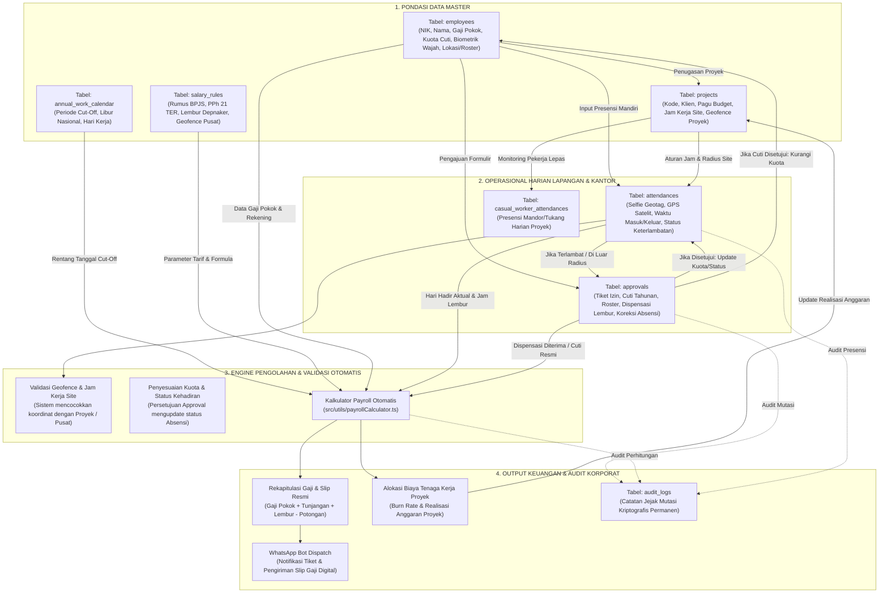
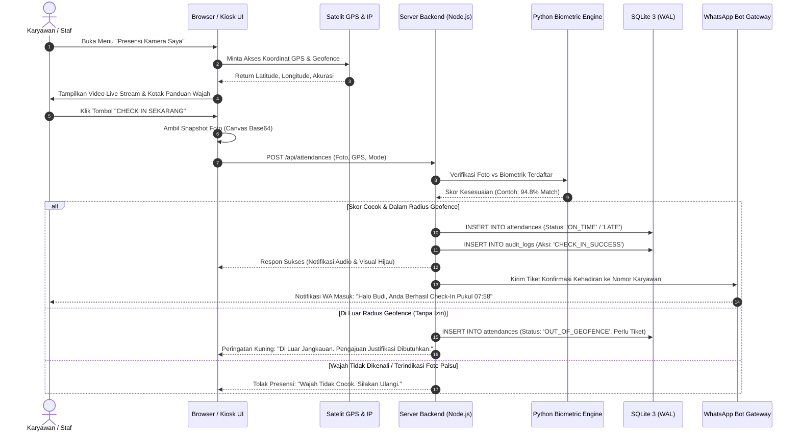
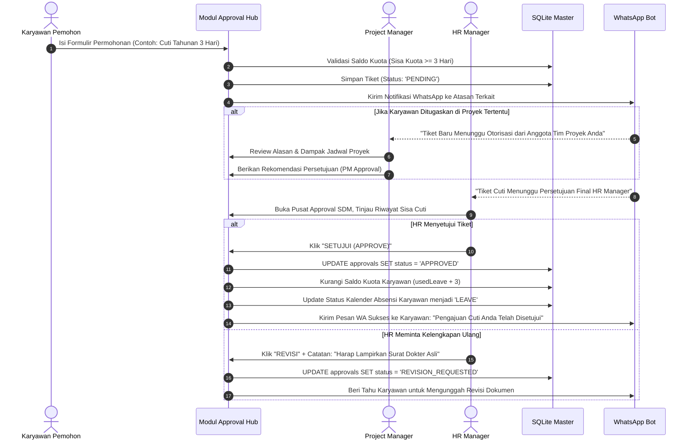
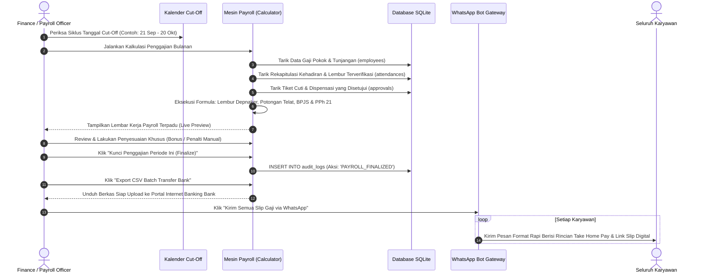

# BUKU PANDUAN PENGGUNAAN SISTEM PRIME HRIS ENTERPRISE
**Versi Sistem:** 2026.10-LTS (Long Term Support)  
**Klasifikasi Dokumen:** Manual Resmi Operasional Sistem & Tata Kelola Data  
**Penyusun:** Systems Architecture & Analytics Platform Lead — Prime Projectx  
**Aplikasi SSOT:** PRIME HRIS (`https://github.com/PrimeFox59/prime-hris.git`)  

---

## DAFTAR ISI

1. [BAB I: PENGENALAN SISTEM & ARSITEKTUR PRIME HRIS](#bab-i-pengenalan-sistem--arsitektur-prime-hris)
   - 1.1 Gambaran Umum & Filosofi Zero Manual System
   - 1.2 Pilar Arsitektur Teknologi & Keamanan
   - 1.3 Matriks Peran & Hak Akses (Role-Based Access Control / RBAC)
2. [BAB II: STRUKTUR DATA, ENTITAS & KETERKAITAN DATA (DATA LINEAGE)](#bab-ii-struktur-data-entitas--keterkaitan-data-data-lineage)
   - 2.1 Diagram Aliran & Keterkaitan Data Antar-Modul (End-to-End)
   - 2.2 Kamus Entitas Data Master & Transaksional
   - 2.3 Matriks Ketergantungan Data (Data Dependency & Impact Matrix)
3. [BAB III: PANDUAN OPERASIONAL PENGGUNA BERDASARKAN PERAN (USER GUIDE)](#bab-iii-panduan-operasional-pengguna-berdasarkan-peran-user-guide)
   - 3.1 Panduan untuk Karyawan / Staf Lapangan & Kantor
   - 3.2 Panduan untuk Project Manager / Site Manager
   - 3.3 Panduan untuk HR / Admin SDM
   - 3.4 Panduan untuk Finance & Payroll Specialist
   - 3.5 Panduan untuk Superuser / Manajemen Direksi
4. [BAB IV: ALUR KERJA OPERASIONAL STANDAR (SOP STEP-BY-STEP)](#bab-iv-alur-kerja-operasional-standar-sop-step-by-step)
   - 4.1 SOP 01: Presensi Harian (Kamera Selfie, Geotag Satelit & Biometrik Wajah)
   - 4.2 SOP 02: Pengajuan Tiket Approval (Cuti, Izin, Lembur, Dinas Luar & Koreksi)
   - 4.3 SOP 03: Presensi Harian Pekerja Lapangan Lepas (Casual Workers / Tukang)
   - 4.4 SOP 04: Siklus Penggajian Bulanan (Cut-Off, Kalkulasi Upah, Pajak & Kirim WA)
   - 4.5 SOP 05: Terminal Presensi Cepat Kiosk Publik (Lobby & Site Gate)
5. [BAB V: PANDUAN INTEGRASI & SISTEM NOTIFIKASI OTOMATIS](#bab-v-panduan-integrasi--sistem-notifikasi-otomatis)
   - 5.1 Integrasi WhatsApp Bot Gateway (Baileys Engine & Verified Opt-In)
   - 5.2 Integrasi SMTP Email Gateway (Nodemailer Transporter)
   - 5.3 Engine Pengenalan Wajah AI (Face Descriptor Matching & Anti-Spoofing)
6. [BAB VI: TROUBLESHOOTING, AUDIT TRAIL & FAQ](#bab-vi-troubleshooting-audit-trail--faq)
   - 6.1 Audit Trail Kriptografis & Penelusuran Insiden Data
   - 6.2 Panduan Penanganan Masalah Lapangan (GPS, Kamera, Jaringan, Akun)
   - 6.3 Pertanyaan yang Sering Diajukan (FAQ)

---

## BAB I: PENGENALAN SISTEM & ARSITEKTUR PRIME HRIS

### 1.1 Gambaran Umum & Filosofi Zero Manual System
**PRIME HRIS** adalah sistem manajemen sumber daya manusia enterprise yang dirancang khusus untuk memenuhi kebutuhan operasional multi-cabang, multi-proyek, dan tenaga kerja hibrida (kantor pusat, workshop perakitan, dan site tambang/konstruksi).

Filosofi inti PRIME HRIS adalah **Zero Manual System**:
- **Otomatisasi Penuh:** Eliminasi total pencatatan presensi kertas, spreadsheet rekapitulasi lembur manual, dan distribusi slip gaji fisik.
- **Validasi Berlapis Multi-Faktor:** Presensi divalidasi silang menggunakan biometrik wajah AI 128-vektor, koordinat GPS satelit radius meter (Geofencing), serta deteksi IP Gateway jaringan kantor.
- **Integritas Waktu Nyata:** Setiap transaksi absensi dan persetujuan langsung mengalir otomatis ke dalam kalkulator penggajian, buku besar anggaran proyek, dan notifikasi pesan instan WhatsApp secara *real-time*.

### 1.2 Pilar Arsitektur Teknologi & Keamanan
PRIME HRIS dibangun dengan tumpukan teknologi modern berkecepatan tinggi:
1. **Frontend Layer:** React 18, TypeScript, Tailwind CSS, Lucide Icons, dan Apache ECharts untuk visualisasi telemetri analitik. Responsif penuh untuk penggunaan desktop kantor, tablet kios lobby, maupun smartphone Android/iOS.
2. **Backend Engine:** Node.js HTTP Server mandiri dengan kompresi data otomatis GZIP, Server-Sent Events (SSE) / WebSocket untuk sinkronisasi live data, serta integrasi engine AI Python (`face_engine_vps.py`).
3. **Database Layer:** Engine SQLite 3 native (`node:sqlite`) dengan arsitektur **WAL (Write-Ahead Logging)** dan `PRAGMA synchronous = NORMAL`. Memastikan performa baca/tulis instan di bawah 5 milidetik dengan jaminan integritas data ACID tanpa ketergantungan database eksternal yang rentan putus koneksi.
4. **Security & Cryptography:**
   - Password disimpan menggunakan hashing **PBKDF2/SHA-512** dengan garam acak (*unique salt*) per akun.
   - Sesi autentikasi diamankan menggunakan JSON Web Signature (JWT) berbasis header `Authorization: Bearer <token>`.
   - Modul **Audit Trail** merekam setiap mutasi data finansial dan presensi secara permanen dengan stempel waktu UTC, identitas pelaku, NIK, dan alamat IP Address asal.

### 1.3 Matriks Peran & Hak Akses (Role-Based Access Control / RBAC)
Sistem menerapkan pemisahan tugas (*Segregation of Duties*) melalui 5 tingkatan peran sistem:

| Peran Sistem (`systemRole`) | Profil Pengguna | Cakupan Akses & Tanggung Jawab Utama |
| :--- | :--- | :--- |
| **`superuser`** | Direksi, Technical Director, Platform Architect | Akses tanpa batas ke seluruh sistem, master konfigurasi gaji & geofence, audit trail level root, tagihan invoice, dan pemulihan database. |
| **`hr` / `admin`** | HR Manager, Supervisor Personalia | Pengelolaan master data karyawan, pendaftaran biometrik wajah, approval berjenjang cuti/izin/lembur, kalender kerja cut-off, dan koreksi timesheet. |
| **`finance`** | Finance Manager, Payroll Officer | Pengelolaan perhitungan penggajian (Payroll), rekap lembur formula Depnaker, pembebanan biaya ke proyek, export transfer bank, dan distribusi slip gaji WA. |
| **`staff` (Project Manager)** | Site Lead, Site Coordinator, PM Lapangan | Dashboard proyek yang dikelola, otorisasi dispensasi teknisi lapangan, dan pencatatan presensi foto harian tukang/pekerja harian lepas (*Casual Workers*). |
| **`staff` (General Staff)** | Karyawan Kantor, Teknisi, Operator | Portal kehadiran mandiri (Selfie + GPS), pengajuan cuti & izin, monitoring sisa jatah cuti tahunan, dan pencetakan slip gaji pribadi. |

---

## BAB II: STRUKTUR DATA, ENTITAS & KETERKAITAN DATA (DATA LINEAGE)

### 2.1 Diagram Aliran & Keterkaitan Data Antar-Modul (End-to-End)

### 2.2 Kamus Entitas Data Master & Transaksional

#### A. Entitas `employees` (Master Karyawan)
Menyimpan profil lengkap identitas karyawan, kompensasi finansial, saldo hak cuti, hingga fitur biometrik.
- **Kunci Utama (`id`):** Format `EMP-XXX` (Contoh: `EMP-001`, `EMP-002`). Unik dan tidak berubah.
- **`nik`:** Nomor Induk Karyawan perusahaan yang digunakan sebagai nomor referensi resmi dan ID Kiosk.
- **`baseSalary`, `fixedAllowance`, `dailyAllowance`:** Komponen gaji pokok, tunjangan tetap (jabatan/keahlian), dan tunjangan harian (transportasi & konsumsi yang hanya cair jika hadir kerja).
- **`assignedProjectId`:** Menghubungkan karyawan dengan proyek aktif di tabel `projects`. Mengatur jadwal kerja, geofence, dan alokasi pembebanan biaya gaji.
- **`leaveQuota` & `usedLeave`:** Saldo kuota hak cuti tahunan dan jumlah hari cuti yang telah digunakan. Terpotong otomatis saat tiket approval cuti disetujui HR.
- **`biometric` (Objek JSON):** Menyimpan array 128-float representasi vektor wajah hasil ekstraksi AI model FaceNet/ResNet, tanggal pendaftaran (*enrolledAt*), dan foto acuan biometrik.
- **`workLocationType` ('LOKAL' | 'NON_LOKAL'):**
  - **LOKAL:** Karyawan dengan skema kerja reguler mingguan (Senin-Jumat/Sabtu).
  - **NON_LOKAL:** Karyawan spesialis lapangan/site dengan skema kerja giliran (*Roster Cycle*, misal: 10 minggu bertugas di site, 2 minggu cuti roster off-site).
- **`bankAccount`:** Menyimpan informasi nama bank, nomor rekening, dan nama pemilik rekening untuk kebutuhan transfer batch payroll.

#### B. Entitas `projects` (Master Proyek & Manajemen Site)
Menyimpan spesifikasi proyek korporat tempat karyawan dan teknisi ditugaskan.
- **Kunci Utama (`id`):** Format `PRJ-XXX` (Contoh: `PRJ-001`, `PRJ-002`).
- **`code` & `name`:** Kode unik kontrak proyek (contoh: `DMJ-CORP-2026`) dan nama operasional proyek.
- **`allocatedBudget`:** Pagu anggaran total yang dialokasikan untuk tenaga kerja (*Labor Budget*).
- **`actualLaborCost`:** Akumulasi realisasi biaya upah tenaga kerja yang telah dibayarkan dari siklus payroll.
- **`projectManagerId`:** NIK/ID dari Project Manager yang berwenang menyetujui dispensasi tim dan presensi tukang proyek.
- **`customRules` (Pengaturan Khusus Proyek):**
  - `workSchedule`: Mengesampingkan (*override*) jam masuk dan keluar standar kantor (contoh: shift tambang/pabrik masuk 07:00, keluar 16:00).
  - `geofence`: Titik koordinat Latitude, Longitude, dan radius toleransi GPS meter khusus site proyek bersangkutan.

#### C. Entitas `attendances` (Data Presensi Transaksional)
Mencatat setiap peristiwa kehadiran masuk dan pulang karyawan secara harian.
- **Kunci Utama (`id`):** Menggunakan format stempel waktu unik (contoh: `ATT-1730302800000`).
- **`employeeId` & `employeeNik`:** Merujuk langsung ke tabel `employees`.
- **`date`:** Format tanggal `YYYY-MM-DD` (Kunci partisi pencarian presensi harian).
- **`checkInTime` & `checkOutTime`:** Format waktu `HH:mm:ss`. Waktu kepulangan dapat kosong hingga karyawan melakukan absen pulang.
- **`mode`:** Pilihan tipe presensi (`OFFICE` = Kantor Pusat, `PROJECT_SITE` = Site Proyek, `REMOTE` = Dinas/WFH, `KIOSK` = Terminal Presensi).
- **`status`:** Status kehadiran akhir (`ON_TIME`, `LATE`, `DINAS_LUAR`, `LEAVE`, `SICK`, `ALPHA`).
- **`photoUrl`:** Bukti tangkapan foto selfie dari kamera webcam/smartphone saat menekan tombol presensi.
- **`lateMinutes` & `lateReason`:** Menit keterlambatan yang dihitung otomatis dari selisih waktu masuk terhadap batas toleransi jadwal, beserta alasan tertulis dari karyawan.
- **`data_json`:** Metadata komprehensif berformat JSON yang memuat koordinat GPS riil, akurasi GPS satelit, skor kecocokan biometrik wajah (*matchScore*), dan IP Gateway perangkat.

#### D. Entitas `approvals` (Workflow Tiket Persetujuan SDM & Proyek)
Menyimpan seluruh pengajuan perizinan karyawan yang membutuhkan otorisasi berjenjang.
- **`type`:**
  - `LEAVE`: Cuti Tahunan, Cuti Sakit, Cuti Roster Non-Lokal, Cuti Melahirkan, Cuti Menikah, Cuti Duka.
  - `PERMIT`: Izin Pribadi, Izin Medis, Dispensasi Khusus.
  - `LATE_JUSTIFICATION`: Permohonan pembatalan/penghapusan penalti potongan keterlambatan absensi karena alasan valid (macet parah, kecelakaan kerja, kerusakan sistem).
  - `DINAS_LUAR`: Penugasan kerja di luar wilayah kantor/site proyek yang sah.
  - `ATTENDANCE_CORRECTION`: Permohonan koreksi jam absensi jika karyawan lupa melakukan scan check-in/out.
  - `OUT_OF_GEOFENCE`: Izin presensi di luar radius satelit GPS yang ditentukan.
- **`status`:** `PENDING` (Menunggu Otorisasi), `APPROVED` (Disetujui), `REJECTED` (Ditolak), `REVISION_REQUESTED` (Meminta Revisi Lampiran).
- **`targetApproverRole`:** Mengarahkan tiket ke antrean otorisasi yang tepat:
  - `PM`: Diperiksa terlebih dahulu oleh Project Manager terkait.
  - `HR`: Diputuskan secara final oleh HR Manager.

#### E. Entitas `annual_work_calendar` (Kalender Kerja & Pengaturan Cut-Off)
Mengontrol validitas hari kerja korporat dan siklus penggajian bulanan.
- **`year`:** Tahun kalender operasional.
- **`weeklyOffDays`:** Array hari libur mingguan perusahaan (contoh: `[0, 6]` untuk Sabtu & Minggu libur, atau `[0]` untuk hanya hari Minggu libur).
- **`defaultCutoffStartDay` & `defaultCutoffEndDay`:** Batas siklus pencatatan absensi untuk penggajian (Default standar industri: tanggal **21** bulan lalu s/d tanggal **20** bulan berjalan).
- **`defaultPaydayDate`:** Tanggal pembayaran gaji resmi (Default: tanggal **25**).

#### F. Entitas `casual_workers` & `casual_worker_attendances` (Pekerja Lapangan Lepas)
Khusus mengelola tenaga kerja harian lepas, kuli, tukang, dan spesialis sub-kontraktor di lokasi proyek tanpa perlu membuatkan akun login ke sistem.
- Diinput dan diawasi langsung oleh Project Manager di lapangan menggunakan kamera ponsel, mencatat nama tukang, jam masuk, titik GPS proyek, dan foto bukti fisik harian di lapangan.

---

## BAB III: PANDUAN OPERASIONAL PENGGUNA BERDASARKAN PERAN (USER GUIDE)

### 3.1 Panduan untuk Karyawan / Staf Lapangan & Kantor

#### A. Halaman "Portal Kinerja Saya" (Dashboard Pribadi)
Setelah login menggunakan Username/Email dan Password, karyawan akan langsung disambut oleh ringkasan pribadi:
- **Kartu Statistik Kehadiran:** Menampilkan jumlah hadir tepat waktu, menit keterlambatan bulan ini, sisa kuota cuti tahunan, dan pengajuan tiket yang sedang diproses.
- **Roster & Penugasan Proyek:** Menampilkan nama proyek aktif tempat karyawan ditugaskan beserta nama Project Manager yang bertanggung jawab.
- **Quick Actions:** Akses cepat untuk menuju menu Presensi Kamera atau Mengajukan Cuti.

#### B. Melakukan Presensi Masuk & Pulang (Presensi Kamera Saya)
1. Buka menu **PRESENSI KAMERA SAYA** pada bilah navigasi kiri.
2. Izinkan browser untuk mengakses **Kamera** dan **Lokasi (GPS Satelit)**.
3. Posisikan wajah tepat di dalam lingkaran panduan oval di layar hingga sistem mendeteksi wajah dengan status *"Wajah Terdeteksi (Kualitas Baik)"*.
4. Periksa indikator satelit:
   - **Indikator Hijau (Dalam Radius Kantor/Proyek):** Jarak Anda berada di dalam radius resmi.
   - **Indikator Kuning/Merah (Di Luar Radius):** Anda berada di luar area kantor/proyek. Jika memilih mode *Dinas Luar*, sistem akan meminta Anda menuliskan keterangan dinas luar secara jujur.
5. Tekan tombol besar **"CHECK IN SEKARANG"** (pada pagi hari) atau **"CHECK OUT SEKARANG"** (saat jam kerja berakhir).
6. Sistem akan memverifikasi kecocokan wajah dengan biometrik master Anda dalam 0.5 detik, menyimpan foto snapshot, dan menampilkan pesan konfirmasi sukses beserta notifikasi WhatsApp otomatis ke ponsel Anda.

#### C. Mengajukan Izin, Cuti & Dispensasi Lembur (Pengajuan & Izin Saya)
1. Buka menu **PENGAJUAN & IZIN SAYA**, lalu klik tombol biru **"+ BUAT PENGAJUAN BARU"**.
2. Pilih kategori permohonan:
   - **Cuti Tahunan / Roster:** Masukkan rentang tanggal (mulai s/d selesai). Sistem secara cerdas akan menghitung jumlah hari kerja bersih (mengabaikan hari libur nasional dan hari libur mingguan) serta menampilkan sisa kuota cuti Anda.
   - **Izin Sakit / Keperluan Pribadi:** Masukkan tanggal dan unggah bukti pendukung (contoh: surat keterangan dokter / foto surat resmi).
   - **Dispensasi Keterlambatan (Late Justification):** Pilih absensi hari terkait yang terlambat, lalu tuliskan justifikasi logis agar potongan keterlambatan tidak dikenakan pada gaji Anda.
3. Klik tombol **"KIRIM PENGAJUAN"**. Status pengajuan dapat Anda pantau secara langsung apakah masih `PENDING`, telah `APPROVED`, atau `REVISION_REQUESTED`.

#### D. Memeriksa & Mencetak Slip Gaji (Slip Gaji Saya)
1. Buka menu **SLIP GAJI SAYA**.
2. Pilih periode bulan penggajian yang ingin dilihat.
3. Layar akan menampilkan rincian transparansi slip gaji berstandar resmi:
   - Penghasilan Kotor (*Gross Earnings*): Gaji Pokok, Tunjangan Tetap, Tunjangan Kehadiran Harian, dan Upah Lembur Aktual.
   - Potongan (*Deductions*): Potongan keterlambatan tidak terjustifikasi, iuran BPJS Ketenagakerjaan (JHT 2%, JP 1%), iuran BPJS Kesehatan (1%), dan estimasi Pajak Penghasilan PPh 21 TER.
   - Penghasilan Bersih (*Take Home Pay*).
4. Klik tombol **"CETAK SLIP RESMI (PDF)"** untuk mengunduh slip dalam format siap cetak dengan logo resmi PRIME HRIS, atau klik **"KIRIM KE WHATSAPP SAYA"** untuk meminta sistem mengirimkan salinan digital langsung ke nomor WhatsApp Anda.

---

### 3.2 Panduan untuk Project Manager / Site Manager

#### A. Mengelola Proyek & Penugasan Tim (Manajemen Proyek & Site)
1. Buka menu **MANAJEMEN PROYEK & SITE**.
2. Klik nama proyek Anda untuk melihat detail informasi:
   - Alokasi Anggaran Tenaga Kerja (*Allocated Labor Cost*) vs Realisasi Upah Berjalan (*Actual Labor Cost*).
   - Jam Kerja Proyek (*Site Work Schedule*): Anda dapat mengaktifkan jam kerja khusus jika proyek memiliki jam masuk berbeda dari kantor pusat.
   - Radius Geofence Site: Memastikan teknisi yang bertugas hanya dapat melakukan check-in ketika berada di area fisik proyek konstruksi/workshop.

#### B. Presensi Harian Pekerja Lapangan Lepas (Presensi Tukang Lapangan)
Untuk proyek yang melibatkan mandor dan kuli bangunan tanpa akun sistem:
1. Masuk ke menu **PRESENSI TUKANG LAPANGAN**.
2. Pilih proyek yang sedang aktif.
3. Pada tab **Daftar Pekerja**, klik **"+ Tambah Pekerja Lepas"** untuk mendaftarkan nama tukang baru (contoh: Pak Joko - Tukang Las).
4. Pada tab **Presensi Harian Lapangan**:
   - Klik **"Ambil Absen Tukang"**.
   - Arahkan kamera smartphone ke pekerja bersangkutan di lokasi proyek.
   - Sistem akan menyematkan *watermark* koordinat GPS, tanggal, dan nama Project Manager yang memverifikasi.
   - Klik **"Simpan Presensi Tukang"**. Seluruh arsip foto dan log kehadiran harian tersimpan rapi untuk bukti klaim biaya operasional (*reimbursement/progress billing*).

#### C. Otorisasi Tiket Anggota Tim Proyek (Pusat Approval SDM)
1. Setiap kali staf yang terdaftar di bawah proyek Anda mengajukan lembur, dinas luar, atau perizinan, notifikasi akan masuk ke menu **APPROVAL & PENGAJUAN**.
2. Filter status berdasarkan proyek Anda.
3. Periksa kesesuaian uraian tugas lapangan.
4. Klik **"SETUJUI (APPROVE)"** atau **"TOLAK (REJECT)"** dengan memberikan catatan evaluasi tertulis.

---

### 3.3 Panduan untuk HR / Admin SDM

#### A. Master Data Karyawan & Pendaftaran Biometrik (Data Karyawan)
1. Masuk ke menu **DATA KARYAWAN**.
2. Untuk mendaftarkan karyawan baru, klik **"+ TAMBAH KARYAWAN"**:
   - Isi NIK unik, Nama Lengkap, Email, Nomor WhatsApp aktif (format `628...`), Departemen, Jabatan, dan Tanggal Bergabung.
   - Tentukan tipe kompensasi (Gaji Pokok, Tunjangan Tetap, Tunjangan Makan/Transport Harian).
   - Tentukan lokasi kerja: **LOKAL** atau **NON_LOKAL** (serta konfigurasi siklus rostering-nya).
   - Masukkan nomor rekening bank tujuan payroll.
3. **Pendaftaran Biometrik Wajah (Biometric Enrollment):**
   - Pada baris data karyawan bersangkutan, klik ikon **Kamera / Biometrik**.
   - Minta karyawan menghadap ke kamera dengan pencahayaan terang dan tanpa masker/kacamata hitam.
   - Klik tombol **"CAPTURE & ENROLL BIOMETRIC"**.
   - Engine AI akan mengekstrak 128 titik landmark wajah menjadi representasi vektor unik dan menyimpannya secara terenkripsi ke database SQLite.

#### B. Mengelola Kalender Kerja Tahunan & Periode Cut-Off (Kalender Kerja & Cut-Off)
1. Masuk ke menu **KALENDER KERJA & CUT-OFF**.
2. Tentukan hari libur mingguan perusahaan (misal mencentang hari Sabtu dan Minggu).
3. Tandai hari libur nasional resmi pemerintah dan cuti bersama dengan mengklik tanggal pada kalender interaktif.
4. Tentukan parameter Cut-Off siklus penggajian:
   - **Tanggal Mulai Cut-Off:** Default tanggal **21** bulan sebelumnya.
   - **Tanggal Akhir Cut-Off:** Default tanggal **20** bulan berjalan.
   - **Tanggal Pembayaran Gaji (Payday):** Default tanggal **25**.
5. Klik **"SIMPAN KONFIGURASI KALENDER"**. Konfigurasi ini secara instan menjadi acuan mesin payroll dalam mengagregasi hari kerja dan jam lembur staf.

#### C. Otorisasi SDM & Rekonsiliasi Timesheet (Pusat Approval SDM & Timesheet Modal)
1. Pada menu **PUSAT APPROVAL SDM**, tinjau pengajuan cuti tahunan, sakit, dan dispensasi.
2. Saat menyetujui cuti tahunan, sistem otomatis memotong saldo `leaveQuota` karyawan.
3. Jika terdapat perselisihan absensi (misal: karyawan lupa check-out karena pemadaman listrik di site):
   - Masuk ke tab **Payroll & Penggajian**, lalu klik nama karyawan untuk membuka **Employee Timesheet Detail Modal**.
   - Pilih tanggal yang bermasalah, klik **"Koreksi Jam HR"**.
   - Masukkan jam check-in/out yang benar beserta alasan koreksi resmi.
   - Sistem akan memperbarui status kehadiran, menghapus denda keterlambatan jika dijustifikasi, dan mencatat mutasi tersebut ke dalam log audit HR.

---

### 3.4 Panduan untuk Finance & Payroll Specialist

#### A. Rekapitulasi Penggajian Otomatis (Payroll & Penggajian)
1. Buka menu **PAYROLL & PENGGAJIAN**.
2. Pilih **Periode Penggajian** (secara otomatis disesuaikan dengan rentang tanggal cut-off yang aktif pada kalender kerja).
3. Anda dapat memfilter tabel berdasarkan departemen atau proyek tertentu untuk melihat alokasi biaya per unit bisnis.
4. Sistem secara otomatis menghitung secara presisi:
   - **Hari Hadir Aktual:** Jumlah hari absensi masuk kerja yang valid.
   - **Lembur Depnaker:**
     - Jam pertama dikalikan $1.5 \times \text{Upah Per Jam}$.
     - Jam kedua dan seterusnya dikalikan $2.0 \times \text{Upah Per Jam}$ ($\text{Upah Per Jam} = \frac{1}{173} \times \text{Gaji Pokok}$).
   - **Potongan Keterlambatan:** Dihitung dari akumulasi menit keterlambatan yang tidak memiliki approval dispensasi.
   - **Kewajiban Iuran Jaminan Sosial & Pajak:**
     - BPJS Ketenagakerjaan: JHT (2% karyawan, 3.7% perusahaan), JP (1% karyawan, 2% perusahaan), JKK & JKM.
     - BPJS Kesehatan: 1% ditanggung karyawan, 4% ditanggung perusahaan (dengan batas plafon gaji maksimal).
     - PPh 21 TER: Dihitung sesuai kategori status PTKP karyawan (TER A, TER B, atau TER C).

#### B. Pembayaran Massal & Distribusi Slip Gaji Digital
1. **Export Bank Transfer File:** Klik tombol **"EXPORT CSV TRANSFER BANK"** untuk mengunduh daftar transfer batch format siap pakai (sesuai format BCA / Mandiri Corporate Cash Management).
2. **Kirim Slip Gaji via WhatsApp Massal:**
   - Klik tombol hijau **"KIRIM SEMUA SLIP GAJI VIA WHATSAPP"**.
   - Sistem WhatsApp Bot akan memproses pengiriman berkas rincian slip gaji ke nomor masing-masing karyawan secara bergantian dengan jeda jeda aman untuk mencegah spam.

#### C. Pengendalian Biaya Tenaga Kerja Proyek (Biaya Tenaga Kerja Proyek)
1. Masuk ke sub-tab **Biaya Tenaga Kerja Proyek**.
2. Pantau metrik *Burn Rate*:
   - Apakah realisasi gaji teknisi pada proyek tertentu melebihi pagu anggaran (*Overbudget*)?
   - Estimasi biaya tenaga kerja hingga proyek selesai (*Estimate at Completion / EAC*).

---

### 3.5 Panduan untuk Superuser / Manajemen Direksi

#### A. Dashboard Terpadu Eksekutif (Dashboard Terpadu)
Menampilkan metrik performa tingkat tinggi organisasi:
- Total tenaga kerja aktif (Headcount rasio Staff Kantor vs Teknisi Lapangan).
- Persentase tingkat kehadiran harian perusahaan (*Attendance Rate*).
- Total liabilitas pengeluaran payroll bulan berjalan.
- Log transaksi terbaru dan status kesehatan engine background service.

#### B. Konfigurasi Aturan Perusahaan & Master Geofence (Setting System)
1. Buka menu **SETTING SYSTEM**.
2. **Aturan Geofence Kantor Pusat:**
   - Masukkan Latitude dan Longitude koordinat kantor pusat.
   - Atur batas radius toleransi GPS (misal: 100 meter).
   - Masukkan daftar Alamat IP Publik kantor untuk mengaktifkan validasi ganda koneksi Wi-Fi kantor.
3. **Konfigurasi WhatsApp Bot Gateway:**
   - Pindai kode QR WhatsApp jika bot terputus (*Unpaired*).
   - Periksa daftar nomor telepon karyawan yang telah berstatus *Opt-In Terverifikasi*.
4. **Konfigurasi SMTP Email Server:**
   - Atur Host SMTP (misal: `smtp.gmail.com`), Port (587 / 465), dan Kredensial Email Pengirim untuk pengiriman notifikasi formal dan reset kata sandi.

#### C. Pengawasan Keamanan & Integritas Data (Audit Trail & Log)
1. Masuk ke menu **AUDIT TRAIL & LOG**.
2. Seluruh mutasi sistem terekam secara kronologis dengan informasi:
   - Siapa yang melakukan perubahan (Nama, NIK, dan Peran).
   - Modul yang dimodifikasi (`EMPLOYEES`, `PROJECTS`, `ATTENDANCE`, `PAYROLL`, `APPROVALS`).
   - Alamat IP perangkat pengguna dan stempel waktu presisi milidetik.
   - Rincian perubahan data sebelum dan sesudah diedit.
3. Log audit bersifat *Append-Only* (tidak dapat diubah maupun dihapus oleh pengguna manapun) demi menjamin kepatuhan audit IATF / ISO korporat.

---

## BAB IV: ALUR KERJA OPERASIONAL STANDAR (SOP STEP-BY-STEP)

### 4.1 SOP 01: Presensi Harian (Kamera Selfie, Geotag Satelit & Biometrik Wajah)

**Langkah-Langkah Operasional Pengguna:**
1. Karyawan berdiri di area kantor atau proyek resmi, menyalakan koneksi GPS pada perangkat.
2. Membuka sistem PRIME HRIS dan memilih tab **Presensi Kamera**.
3. Memastikan wajah bersih dari penghalang, mengarahkan kamera ke wajah, lalu menekan tombol **Check-In**.
4. Sistem memeriksa tiga lapis validasi secara simultan:
   - **Geofence Check:** Menghitung jarak Euclidean koordinat perangkat terhadap pusat lokasi kerja menggunakan rumus *Haversine*. Toleransi standar: $\le 100$ meter.
   - **Biometric Landmark Check:** Membandingkan fitur wajah dengan master data pendaftaran awal.
   - **Time Threshold Check:** Membandingkan jam saat tombol ditekan dengan jadwal shift kerja (misal: jadwal masuk 08:00, toleransi s/d 08:15).
5. Jika check-in dilakukan setelah jam toleransi, sistem otomatis menandai status `LATE`, menghitung jumlah menit keterlambatan, dan menampilkan dialog formulir alasan terlambat.

---

### 4.2 SOP 02: Pengajuan Tiket Approval (Cuti, Izin, Lembur, Dinas Luar & Koreksi)

---

### 4.3 SOP 03: Presensi Harian Pekerja Lapangan Lepas (Casual Workers / Tukang)
1. **Pendaftaran Nama Tukang Lapangan:**
   - Dilakukan oleh Project Manager / Mandor Proyek saat pekerja pertama kali mulai bekerja di lokasi site.
   - Buka menu **Presensi Tukang Lapangan** $\rightarrow$ Tab **Daftar Pekerja** $\rightarrow$ Masukkan nama lengkap tukang dan pilih proyek penugasan aktif.
2. **Pengambilan Presensi Harian di Site:**
   - Setiap pagi hari di lokasi proyek, Project Manager membuka menu **Presensi Tukang Lapangan** $\rightarrow$ Klik **Ambil Absen Harian**.
   - Kamera smartphone akan aktif. Arahkan kamera ke pekerja bersangkutan di lokasi kerja proyek.
   - Klik **Ambil Foto & Simpan Presensi**.
   - Sistem secara otomatis menempelkan informasi permanen: Nama Pekerja, Nama Project Manager Pemverifikasi, Titik Koordinat GPS Proyek, Tanggal, dan Jam Masuk.
3. **Audit & Rekapitulasi Proyek:**
   - Data presensi tukang langsung terhubung ke modul **Biaya Tenaga Kerja Proyek** untuk perhitungan upah harian lepas dan pencairan kas kecil lapangan (*Site Petty Cash*).

---

### 4.4 SOP 04: Siklus Penggajian Bulanan (Cut-Off, Kalkulasi Upah, Pajak & Kirim WA)

---

### 4.5 SOP 05: Terminal Presensi Cepat Kiosk Publik (Lobby & Site Gate)
Terminal Kiosk dirancang untuk perangkat tablet/layar sentuh yang dipasang permanen di pintu masuk kantor atau pos keamanan workshop:
1. **Cara Mengakses Mode Kiosk:**
   - Buka browser pada tablet kiosk dan akses alamat web dengan menambahkan parameter kiosk:
     `https://hris.primeprojectx.net/?tab=kiosk` atau `?kiosk=true`
2. **Keamanan Data Publik:**
   - Mode Kiosk beroperasi dalam isolasi aman (*Sandboxed Public Mode*).
   - Layar kiosk **sama sekali tidak menampilkan** data rahasia seperti besaran gaji, nomor rekening bank, kartu keluarga, maupun alamat tempat tinggal staf.
3. **Alur Presensi Kiosk:**
   - Karyawan mendekati tablet kiosk.
   - Pilihan 1: **Pengenalan Wajah Otomatis:** Karyawan menatap kamera kiosk; sistem secara otomatis mencocokkan wajah dengan galeri biometrik dalam waktu $< 0.8$ detik dan langsung mencatat absensi masuk/pulang.
   - Pilihan 2: **PIN Cepat / NIK:** Karyawan mengetikkan 4 digit NIK/PIN pada keypad layar sentuh, lalu sistem mengambil foto verifikasi kilat dan mencatat kehadiran.

---

## BAB V: PANDUAN INTEGRASI & SISTEM NOTIFIKASI OTOMATIS

### 5.1 Integrasi WhatsApp Bot Gateway (Baileys Engine & Verified Opt-In)
PRIME HRIS dilengkapi dengan mesin gateway WhatsApp mandiri berbasis library **Baileys Multi-Device**:
- **Koneksi Stabil Tanpa Biaya Pihak Ketiga:** Terhubung langsung ke WhatsApp Web socket tanpa memerlukan gateway berbayar bulanan.
- **Mekanisme Anti-Banned (Verified Opt-In):**
  - Untuk melindungi nomor WhatsApp operasional perusahaan dari pemblokiran otomatis sistem keamanan WhatsApp, sistem menerapkan tabel `wa_opt_ins`.
  - Karyawan baru dianjurkan mengirimkan pesan pertama kali (misal mengetik pesan *"Halo HRIS"*) ke nomor WhatsApp Bot perusahaan.
  - Setelah tercatat di sistem, nomor tersebut memiliki status aman (*Whitelisted Opt-In*) untuk menerima slip gaji dan notifikasi sistem tanpa risiko dianggap spam.
- **Pengecekan Status Bot:**
  - Buka menu **Setting System** $\rightarrow$ Tab **WhatsApp Gateway**.
  - Jika status menunjukkan *Disconnected / Unpaired*, klik tombol **"TAMPILKAN QR PAIRING"** dan pindai kode QR menggunakan menu Perangkat Tertaut pada smartphone WhatsApp kantor.

### 5.2 Integrasi SMTP Email Gateway (Nodemailer Transporter)
- Digunakan untuk pengiriman notifikasi formal berkas resmi korporat, laporan mingguan eksekutif ke Direksi, serta tautan pemulihan kata sandi (*Password Reset*).
- Konfigurasi parameter pada menu **Setting System** $\rightarrow$ Tab **Email Server**:
  - `SMTP Host`: `smtp.gmail.com` (atau SMTP server korporat).
  - `SMTP Port`: `587` (TLS) atau `465` (SSL).
  - `User`: Alamat email resmi HRD (contoh: `hris@primeprojectx.net`).
  - `Password`: Kredensial *Google App Password* 16 digit.

### 5.3 Engine Pengenalan Wajah AI (Face Descriptor Matching & Anti-Spoofing)
- Menggunakan arsitektur jaringan saraf tiruan dalam ekstraksi 68 titik kontur wajah (mata, hidung, rahang, bibir).
- **Vektor 128-Dimensi:** Setiap wajah diubah menjadi representasi koordinat matematis 128 dimensi.
- **Pencocokan Euclidean Distance:**
  - Jarak Euclidean $\le 0.45$: Dinyatakan sebagai orang yang sama dengan tingkat keyakinan sangat tinggi ($> 95\%$).
  - Jarak Euclidean $> 0.60$: Ditolak sebagai orang yang berbeda.
- **Anti-Spoofing:** Mendeteksi kedalaman kontur dan mikro-kedipan mata untuk mencegah kecurangan absensi menggunakan foto cetak atau rekaman layar smartphone.

---

## BAB VI: TROUBLESHOOTING, AUDIT TRAIL & FAQ

### 6.1 Audit Trail Kriptografis & Penelusuran Insiden Data
Jika terjadi perselisihan data (contoh: kecurigaan manipulasi jam lembur atau perubahan nomor rekening karyawan):
1. Masuk ke menu **AUDIT TRAIL & LOG**.
2. Gunakan kolom pencarian dengan kata kunci nama karyawan, NIK, atau modul yang dicurigai (misal: `PAYROLL` atau `EMPLOYEES`).
3. Periksa rincian rekaman audit:
   - Tanggal dan jam kejadian presisi.
   - Identitas akun yang melakukan aksi (`userName`, `userNik`, `userRole`).
   - Alamat IP komputer pembuat perubahan.
   - Status eksekusi transaksi (`SUCCESS`, `WARNING`, `FAILED`).
4. Setiap rekaman dilindungi integritasnya sehingga menjadi bukti sah dan valid dalam investigasi internal perusahaan.

### 6.2 Panduan Penanganan Masalah Lapangan (Troubleshooting)

| Gejala Masalah | Kemungkinan Penyebab | Tindakan Solusi Mandiri |
| :--- | :--- | :--- |
| **Kamera tidak muncul pada halaman presensi** | Izin kamera diblokir oleh browser Chrome/Safari pada perangkat. | Klik ikon gembok di bilah alamat browser $\rightarrow$ Pilih *Site Settings* $\rightarrow$ Ubah *Camera* menjadi **Allow (Izinkan)** $\rightarrow$ Muat ulang halaman. |
| **Indikator GPS berwarna merah (Di luar radius)** | Akurasi satelit ponsel sedang rendah atau karyawan berada di luar kantor. | Pastikan mode *High Accuracy / Lokasi Presisi* pada ponsel aktif. Berdiri di area yang tidak terhalang atap beton tebal, atau gunakan mode *Dinas Luar* jika sedang tugas resmi. |
| **Wajah tidak dikenali saat verifikasi** | Pencahayaan minim / backlight, atau menggunakan kacamata hitam/masker. | Lepas kacamata dan masker, hadap ke arah sumber cahaya, posisikan wajah di dalam garis oval panduan layar. Jika masih gagal, hubungi HR untuk *Re-Enroll* biometrik. |
| **Pesan WhatsApp Slip Gaji tidak diterima** | Nomor ponsel salah ketik, atau belum melakukan Opt-In pesan pertama. | Periksa nomor telepon di menu Data Karyawan (wajib awalan `628...`). Minta karyawan mengirim pesan WhatsApp apapun ke nomor Bot kantor terlebih dahulu. |
| **Karyawan lupa kata sandi akun** | Lupa password lama. | Hubungi HR atau Superuser. HR dapat membuka menu Data Karyawan $\rightarrow$ Klik aksi **"Reset Password"** untuk mengembalikan kata sandi ke standar default aman. |

### 6.3 Pertanyaan yang Sering Diajukan (FAQ)

**Q1: Apakah data absensi tetap tersimpan jika koneksi internet terputus di tengah jalan?**  
*A1: Ya. Frontend PRIME HRIS dilengkapi dengan penyimpanan lokal sementara (*Local Caching*). Saat koneksi terhubung kembali, sistem akan mengirimkan data absensi yang tertunda ke server SQLite pusat.*

**Q2: Bagaimana jika seorang teknisi ditugaskan ke beberapa proyek yang berbeda dalam satu bulan?**  
*A2: Sistem mendukung pencatatan jam kerja berbasis multi-proyek. Project Manager masing-masing proyek dapat menyetujui porsi jam kerja teknisi bersangkutan, dan sistem payroll akan secara otomatis membagi proporsi pembebanan biaya gaji (*Labor Cost Allocation*) ke masing-masing proyek secara adil.*

**Q3: Kapan saldo hak cuti tahunan karyawan diperbarui?**  
*A3: Hak cuti tahunan diberikan sesuai kebijakan perusahaan (misal 12 hari per tahun setelah melewati masa kerja 1 tahun). Pengurangan saldo terjadi secara otomatis dan seketika (*real-time*) tepat saat HR Manager menekan tombol persetujuan tiket cuti.*

**Q4: Apakah sistem mendukung ekspor data untuk laporan audit eksternal?**  
*A4: Seluruh modul (Presensi, Payroll, Approval, dan Audit Trail) memiliki fitur ekspor instan ke format file Excel (CSV/XLSX) dan format cetak PDF berstandar korporat.*

---

**Selesai Dokumen Buku Panduan**  
*PRIME HRIS Enterprise — Systems Architecture & Platform Engineering Ecosystem*  
*PT Prime Infinity Systems / PT Pakarti Riken Indonesia / Prime Projectx*
